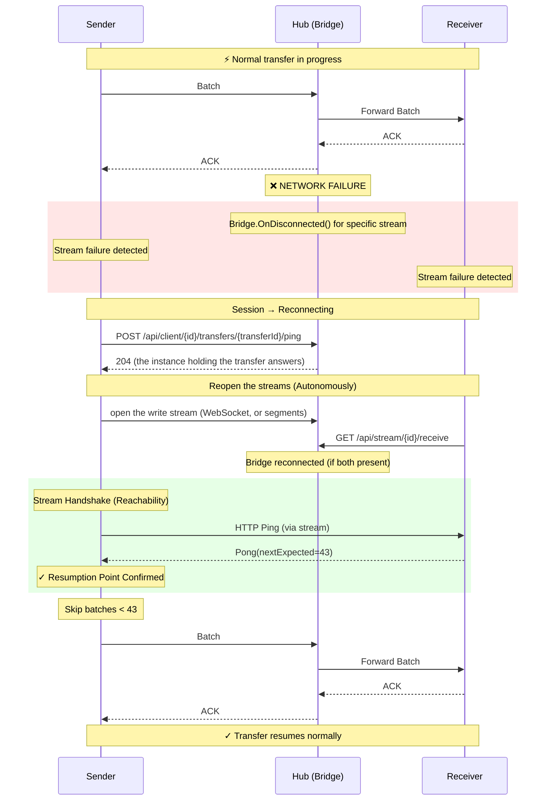
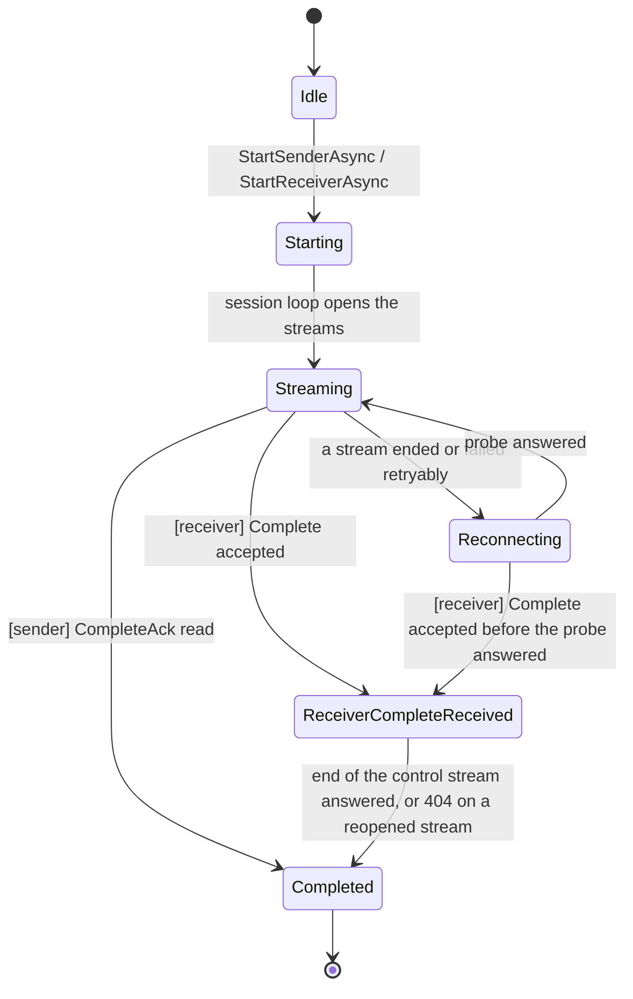

# Resilience & Reachability Architecture

> Technical documentation of TransportR's fault tolerance mechanisms

## Overview

TransportR implements a **"Dataplane First" resilience pattern** where:
1.  **State is driven by streams**: HTTP streams interactions determine the transfer state.
2.  **Resumption via Stream Handshake**: After a cut, the client probes the hub with a request, then reopens its streams and exchanges Ping/Pong on the new data stream, which carries the resume point.
3.  **Smart Resend**: Stream Handshake tells the sender exactly which batch was last processed (Packet Level Ack), enabling precise resumption without duplicates.
4.  **Hub Lifecycle Management**: The Hub acts as a passive router + active monitor (Reaper), terminating silent transfers (and, opt-in, stalled ones) but not orchestrating recovery.

---

## Key Timings

The one table of timings. A value the code keeps in a constant names its `file:line`. A **fixed** value has no setting:
no route from the builder on the client, no options property on the hub. Any other is set where the *Settable* column
says: a builder method on the client, an options class on the hub.

| Side | Name | Default | Settable | What it bounds |
|---|---|---|---|---|
| client | `ClientOptions.PongTimeout` | 10 s | **fixed** | Wait for the in-stream `Pong` that carries the resume point |
| client | Reconnect probe (`ReconnectionHandler.cs:12`) | 5 s | **fixed** | One `POST /api/client/{id}/transfers/{transferId}/ping` to the instance holding the transfer's bridge while `Reconnecting`: a `2xx`, or a `404` carrying `TransportR-Refused`, means the hub answers |
| client | Reconnect pause (`DataSession.cs:631`) | 2 s | **fixed** | Pause after a failed probe |
| client | Closing-phase retry (`DataSession.cs:28`) | 500 ms | **fixed** | Receiver: pause between two attempts to reopen a stream once it has received `Complete` |
| client | Session loop error pause (`DataSession.cs:658`) | 1 s | **fixed** | Pause after an unexpected error in the session loop |
| client | `Complete` resend (`DataSession.cs:24`) | 5 s | **fixed** | Interval between two `Complete` signals while nothing acknowledges |
| client | `ClientOptions.CompleteStallTimeout` | 60 s | **fixed** | Silence tolerated, since the last acknowledgement, by `CompleteAsync` and by a producer parked on a full send window |
| client | Abort write (`DataSession.cs:32`) | 2 s | **fixed** | Wait for `Abort` to reach the wire when a handle is released |
| client | Abort request (`DataSession.cs:35`) | 2 s | **fixed** | The `POST /api/stream/{id}/abort` sent when the `Abort` could not be written |
| client | Read stream end (`HttpStreamManager.cs:57`) | 2 s | **fixed** | Wait for the hub to end the read stream: after it refused the write stream, before the attempt ends; when a completed receiver's handle is released |
| client | `ClientOptions.HandshakeTimeout` | 20 s | **fixed** for a client; a host opening a transfer passes `timeoutMs` to `ITransferInitiator` | `InitTransfer`: the receiver's answer (and a host-opened sender's), the hub applying the value its caller passes; a client's request outside 0 to 5 min (a session's lifetime) is a `400` |
| client | Handshake margin (`TransportRClient.cs:47`) | 10 s | **fixed** | `InitTransferAsync` as a whole, on top of the handshake timeout: the request, its replay after a redirect and the reading of both answers. A hub that has said nothing by then fails the call with a `HubRequestFailedException` |
| client | `ClientOptions.HeartbeatInterval` | 1 s | **fixed** | Per-transfer statistics heartbeat (`POST …/transfers/{transferId}/heartbeat`), which only runs while a transfer does |
| client | Heartbeat request (`DataSession.cs:38`) | 5 s | **fixed** | One transfer heartbeat; a beat still waiting is not joined by the next |
| client | `ClientOptions.PresenceHeartbeatInterval` | 15 s | **fixed** | The presence heartbeat (`POST …/presence/{connectionId}`), which keeps the registration alive between transfers and tells the hub the client is there. Announced when the events stream opens; a beat is bounded by the interval itself. It is also how long a sender's data stream may be idle before it writes a `Ping`, and the keepalive interval of a WebSocket write stream, at both ends |
| client | `ClientOptions.WebSocketOpenBound` | 5 s | **fixed** | Opening a WebSocket write stream, the upgrade and the proof together: past it the path is taken as not carrying one, and the session uses segments |
| client | Short-lived cuts (`HttpStreamManager.cs:62-63`) | 3 in a row, each within 30 s of its opening | **fixed** | Cuts of a proven WebSocket that read as a path not carrying one: segments from then on. A connection that lives 30 s clears the count |
| client | `ClientOptions.StreamBufferSize` | 512 KB | **fixed** | Not a delay: the buffer in front of each data-plane write, which is also the largest segment or WebSocket message it sends |
| client | `ClientOptions.BatchFlushIntervalMs` | 1000 ms | `WithBatchTimeout` | A partial batch's wait before it is flushed; checked every half interval, a millisecond at the least (`Accumulator.cs`, `FlushIntervalLoop`) |
| client | `ClientOptions.TokenRefreshThreshold` | 5 min | `WithTokenRefreshThreshold` | How long before its expiry a token is renewed, and no more than half of what is left of it |
| client | `ClientCredentialsOptions.RefreshThreshold` (`ClientCredentialsOptions.cs:31`) | 5 min | **fixed** | How long before its expiry `WithClientCredentials` stops reusing its cached token |
| client | Renewal request (`TokenRenewer.cs:29`) | 10 s | **fixed** | One `PUT /api/client/{id}/token` |
| client | Renewal retry (`TokenRenewer.cs:30-31`) | 1 s → 30 s | **fixed** | Delay after a failed renewal: doubling, half to full delay, until the expiry |
| client | Events stream, silence (`ControlChannel.cs:40`) | 30 s | **fixed** | A stream that carried nothing, keepalives included, for this long is abandoned and opened again. An opening the hub has not answered with the registration by then fails |
| client | Events stream, first opening (`ControlChannel.cs:44`, `:138-165`) | 5 attempts, 500 ms → 5 s | **fixed** | Attempts to open the first stream, the delay doubling; a refusal is raised at once. Restarting a data stream is not backed off |
| client | Events stream, reopening (`ControlChannel.cs:42-43`) | 1 s → 30 s | **fixed** | After a stream was lost: doubling, half to full delay, no limit |
| hub | Keepalive (`ClientStreams.cs:130`) | 15 s | **fixed** | Quiet on an events stream before the hub writes a `keepalive` event: half the client's silence limit |
| hub | Client silence | twice the announced presence interval (30 s) | **fixed**, announced by the client | An events stream the hub has heard nothing from is closed; any request the hub admits from that client counts as hearing from it |
| hub | Sender's data stream, silence | twice the interval its opening announces (30 s) | **fixed**, announced by the client | A write stream of the sender's data taken as cut: an epoch with no segment, or a WebSocket whose read has waited that long for a byte. No other write stream is judged on silence |
| hub | Segment hold (`UploadEpoch.cs:45`) | 30 s | **fixed** | A segment waiting for the peer to read it: answered `202` with what got through, and the client sends the rest again. Below the 60 s a default nginx allows a request without an answer |
| hub | WebSocket probe (`WebSocketInput.cs:22`) | 10 s | **fixed** | Wait for a WebSocket's probe after the upgrade, above the client's 5 s so that the client is the one to decide about the path |
| hub | WebSocket close (`WebSocketInput.cs:26`) | 2 s | **fixed** | A `Close` the hub sends, and after a `Close(4409)` its wait for the client's own |
| hub | `BridgeTimeoutSeconds` | 300 s | `DataPlaneConfiguration` | A bridge short of `Active` waiting for its peer: the hub cancels it and ends the transfer |
| hub | `TransferInactivityTimeoutSeconds` | 60 s | `DataPlaneConfiguration` | A transfer with no activity at all: no heartbeat, no byte on either stream |
| hub | `StalledProgressTimeoutSeconds` | disabled | `DataPlaneConfiguration` | Opt-in: a transfer alive but whose counters do not move |
| hub | Bridge sweep (`BridgeCleanupService.cs:22`) | 5 s | **fixed** | Interval between two `BridgeTimeoutSeconds` checks |
| hub | Bridge sweep error pause (`BridgeCleanupService.cs:56`) | 10 s | **fixed** | Pause after a failed sweep |
| hub | Transfer sweep (`TransferCleanupService.cs:22`) | 10 s | **fixed** | Interval between two inactivity and stalled-progress checks |
| hub | Session TTL (`TransferManager.cs:20`) | 5 min | **fixed** | Expiry of a transfer's session in the `IStateStore`, pushed back by its heartbeats and by the bytes of its streams |
| hub | Session extension (`TransferManager.cs:21`) | 10 s | **fixed** | At most one extension of that expiry per transfer and interval |
| hub | `DisconnectedGraceSeconds` | 300 s | `ClientRegistryConfiguration` | How long a registration whose events stream ended is kept |
| hub | `ConnectedTtlSeconds` | 3600 s | `ClientRegistryConfiguration` | A connected registration the hub has not heard from at all (stores with server-side expiry) |
| hub | `AccessSweepIntervalSeconds` | 5 s | `AccessOptions` | Interval between two passes that judge every registered client again |
| hub | `TokenExpiryMarginSeconds` | 0 s | `AccessOptions` | How long a token is still honoured after its `exp` |

### Cross-process invariants

- `StalledProgressTimeoutSeconds`, when set, is greater than `BridgeTimeoutSeconds`: a reconnection looks like a stall from the hub. Refused when the
  hub starts (`AddDataHub`).
- `TransferInactivityTimeoutSeconds` is more than twice the shortest heartbeat interval a stream may announce (1 s), or no interval is
  accepted and every stream is refused. Refused when the hub starts (`AddDataHub`).
- `DisconnectedGraceSeconds` equals `BridgeTimeoutSeconds` (300 s) on purpose: a registration is not kept longer than the transfer it would resume.
  Nothing checks it (`ClientRegistryConfiguration`).
- The per-transfer heartbeat (1 s, fixed) is far below `TransferInactivityTimeoutSeconds` (60 s) (`ClientOptions.HeartbeatInterval`). The hub
  checks only that its own value is positive.
- The presence heartbeat (15 s, fixed) is below `ConnectedTtlSeconds` (3600 s), which it refreshes (`ClientOptions.PresenceHeartbeatInterval`).
  The hub checks only that its own value is positive.
- The hub's keepalive (15 s) is half the client's silence limit (30 s), so a stream is abandoned only after two keepalives went missing. Nothing
  compares them, nor either with the idle timeout of a proxy in front of the hub, which has to be above the keepalive.
- The completion stall bound (60 s, fixed) is the client's own (`ClientOptions.CompleteStallTimeout`), and at the hub's defaults it is reached
  first. While `CompleteAsync` waits, the sender's per-transfer heartbeats keep the transfer active, so `TransferInactivityTimeoutSeconds` does
  not end it. The hub ends the transfer of a receiver that went away no sooner than `BridgeTimeoutSeconds` (300 s) later, and that of a receiver
  still connected but no longer reading only on `StalledProgressTimeoutSeconds`, where it is set. Nothing compares the client's bound with them.
- A client renews `min(TokenRefreshThreshold, half of what is left)` before its token's expiry (`TokenRenewer.Advance`); the hub closes it at most
  `AccessSweepIntervalSeconds` after the expiry plus `TokenExpiryMarginSeconds` (`AccessOptions`). Nothing compares the two.

---

## Sequence Diagram: Disconnection & Reconnection



---

## Mechanism Details

### 1. Disconnection Detection (Client-Side)

`HttpStreamManager` reports how each stream attempt ended as a `StreamOutcome`, and `DataSession` decides what follows
(*Client Internals*, below). A stream that fails is `Retryable`, whatever the exception, unless it was cancelled, broke
the wire protocol (`Fatal`) or met a 404 or 410 (`Gone`): the session then reconnects. The manager restarts nothing
itself but a stream refused for an expired token, once. The Hub **DOES NOT** actively notify clients of disconnections
over their events streams (to avoid race conditions).

A batch body the receiver cannot decode is not a cut: it arrived whole, so a resend would decode no better. The
receiver writes `Abort` (`UndecodableBatch`) to the sender, then fails instead of reconnecting; the sender's
`SendAsync` or `CompleteAsync` throws `TransferFailedException`. The other way round, a batch the sender cannot
serialize fails the sender's session at once, and the receiver is told with `Abort` (`SerializationFailed`). Either
`Abort` falls back on `POST /api/stream/{id}/abort` when it cannot be written within `AbortWriteTimeout`.

What a cut is on a write stream depends on its transport (see "Data Plane Transport" in `TransportRArchitecture.md`).
Over segments no connection stays open between two of them to fail: a cut is a segment that fails, which ends the epoch,
and the session reconnects with a new one. Over a WebSocket it is the socket failing, or closing with a status that is
neither the end of the stream nor a refusal. Cuts that follow each other quickly read as a path that does not carry a
WebSocket, and the session goes on over segments (*Key Timings*). Neither end sets a keepalive timeout, so a half-open
WebSocket is seen no sooner by the client than a half-open read GET is.

A dead sender is found by its silence instead, on either transport. One with nothing to write sends a `Ping` every
`PresenceHeartbeatInterval`, and the hub takes a data stream it has heard nothing from for two intervals as cut, the
rule of the presence heartbeat: an epoch with no segment, or a WebSocket whose read has waited that long for a byte (the
keepalive frames are not bytes of the stream, and a hub parked on a slow peer has no read pending, so a slow receiver is
not taken for a silent sender). Only the sender's data stream is judged: a receiver's control stream writes what its
read loop gives it, which a consumer holding on to a batch parks, so its silence says nothing; a dead receiver shows at
its data GET, and the sender then fails for want of acknowledgements.

### 1b. Registration Lifetime (Hub-Side)

A client registration is **not deleted** when its events stream ends: on an unstable network
the same client usually opens a new one within seconds under the same `ClientId`, and removing the
registration would break a transfer that was about to resume. The end of the stream instead stamps
`DisconnectedAtUtc`, which `GetReceivers` exposes through `ClientInfo`.

-   **Nothing filters on it.** A caller that finds nobody fails outright, whereas a caller that
    tries a dead client simply retries, so hiding a briefly silent client is the worse error.
    Callers with more than one candidate should prefer those with no value set.
-   **`DisconnectedGraceSeconds`** (default `300 s`, matching the Bridge Timeout) is how long a
    dropped registration is kept before eviction. It is the window in which a reconnecting client
    can claim its registration back.
-   **`ConnectedTtlSeconds`** (default `3600 s`) is a backstop for registrations orphaned by a hub
    that died before it stamped them. It applies to stores with server-side expiry
    (Redis); the in-memory store keeps connected registrations for the lifetime of the process.
-   **The presence heartbeat** (`POST /api/client/{id}/presence/{connectionId}`) is what refreshes it.
    The client sends it every `PresenceHeartbeatInterval` (default `15 s`) for as long as its stream
    is open, whether or not a transfer is running, so an idle client never expires. Keep the interval
    well below `ConnectedTtlSeconds`.
-   **It is also the hub's view of a cut that closes nothing.** The client announces the interval when
    it opens its stream (`heartbeatMs`), and the hub closes a stream it has heard nothing from for two
    of them (30 s by default); any request the hub admits from the client counts, not this one alone.
    A write to a stream whose peer vanished without closing a connection does not fail, so the hub
    would otherwise see nothing until that connection closed. The stream's end then marks the client
    disconnected, as any other.

> **The per-transfer heartbeats cannot do this job.** The heartbeat of a transfer
> (`POST …/transfers/{transferId}/heartbeat`) is sent by a `DataSession`, which exists only while a
> transfer does, and it reports transfer statistics into `TransferState`. Presence is a property of
> the client, not of a transfer.

### 1c. Losing a Registration While Connected

Three things leave a client holding a stream but unknown to the hub: a hub restart, a registration
evicted past its grace period, and another stream of the same identity that took the registration
over, which then names that stream. In all three, discovery returns nothing for that client and
nobody can open a transfer against it — while its own in-flight transfers keep working, because
resumption is entirely data-plane.

Recovery is the client's, and has two paths:

-   The presence heartbeat is answered **`404`** when the hub holds no registration for the stream.
    The client answers by opening a new stream, which registers it afresh, and closes the old one
    once the new one is registered.
-   A stream that ended (cut, closed by the hub, or silent for 30 s) is opened again after a delay
    (see "Events stream, reopening" in Key Timings), and each opening registers the client. The
    client then restarts the streams of its transfers at once rather than waiting for their next
    failure.

Without this policy the two implementations fail in opposite directions — an in-memory registration
lives forever, and a Redis one expires on a fixed timer whether or not the client is still there.

### 2. Stream Handshake (Reachability & Resume)

The streams are reopened only once the hub answers: a session in `Reconnecting` probes it with an ordinary request
(`POST …/transfers/{transferId}/ping`), carrying the transfer's affinity so that it reaches the instance holding the
bridge, because that is when its streams are worth reopening. The resume point is then not asked of the
Hub (no "Checkpoint"): the Sender asks the Receiver directly **through the new data stream**:

1.  **Sender** sends `ChunkType.Ping` immediately upon connecting the stream.
2.  **Receiver** responds with `ChunkType.Pong`, carrying the `NextExpectedBatchId`.
3.  **Sender** uses this ID to prune its retry buffer.

This ensures that resumption is based on the **Receiver's actual state**, which is the ultimate source of truth.

The `Ping` reaches the receiver on a data stream of its own. A sender's data stream can break inside a chunk, and the hub, which reads none,
cuts the receiver's data GET along with it (`ConnectionBridge`), so that the new stream's bytes are never read as the rest of that chunk. A
clean end cuts nothing. The cost is one reconnection of the receiver for each cut of the sender.

**A batch is the smallest thing this can name**, so the receiver hands one to its consumer whole or not at all: capacity for every item is taken before the first is published, and the hand-off is not cancellable. A batch stopped half way would raise no `NextExpectedBatchId`, be resent whole, and deliver its published prefix to the consumer twice.

```csharp
// Sender Logic
await ChunkIO.WriteChunkAsync(stream, pingChunk);
// ... wait for Pong ...
if (pong.NextExpectedBatchId > currentBatch.Id) {
    Skip(currentBatch); // Already received
}
```

### 3. Hub-Driven Timeout (Dead Transfer Cleanup)

The Hub employs a **TransferCleanupService** that monitors all active transfers.

-   **LastActivityUtc**: Updates on the per-transfer heartbeats, on the probe request (`…/ping`), and on every read the hub makes from one of the transfer's streams: the bytes are counted, never read. A transfer whose streams carry data stays alive while its participants' heartbeats are silent.
-   **Which hub instance judges**: the one that registered the transfer, or that accepted one of its streams. An instance that only looks the transfer up in the shared store (a misrouted request, a check whether the hub still holds it) starts no state, so its sweep never ends a transfer it does not carry.
-   **LastProgressUtc**: Updates ONLY when `ItemsSent`, `AcksReceived`, `ItemsReceived` or `AcksSent` increases.
-   **Inactivity policy** (`TransferInactivityTimeoutSeconds`, default `60 s`): a transfer with no activity at all — neither a heartbeat nor a byte — is terminated, whether or not it ever reported: the hub knows a transfer from its registration, or from the first of its streams it accepts. Because heartbeats and probes refresh `LastActivityUtc`, this deliberately does **not** fire for a peer that is connected but stuck.
-   **Stalled-progress policy** (`StalledProgressTimeoutSeconds`, default **disabled**): a transfer that is alive but whose counters have not moved is terminated. This is the "Zombie" case (a deadlock or a client issue).
-   **Why the second one is opt-in**: from the hub, a reconnection is indistinguishable from a stall — no progress happens during either. A value at or below the Bridge Timeout would kill transfers that would have recovered, so the hub refuses it when it starts, and the deployment has to name the longest outage it intends to survive before enabling it.
-   **What the clients see**: a transfer the hub ends (these policies, a bridge past its timeout, the access sweep, a host, or a participant's abort request below) is cancelled on both clients with a `cancel-transfer` event. Each session then *fails* with "The hub ended the transfer before it completed.": a parked `SendAsync`, a `CompleteAsync` waiting for the acknowledgement, the enumeration (after the items already received) and `WaitForCompletionAsync` throw `TransferFailedException` as the session stops, and nothing is sent to the peer, which the hub told. The streams the clients then cut end at the hub as `Information` lines, because it no longer holds the transfer; the same cut on a transfer it still holds is a warning, a client that should reconnect. A host releasing its handle is a different ending and says so ("released before the transfer completed").
-   **Not a liveness check**: a transfer whose participant's token ran out, or whose groups may no longer reach each other, is ended by the access sweep instead (see "Token Renewal" in `SecurityArchitecture.md`).

### 4. Affinity Handoff (HA)

In a multi-hub deployment behind a load balancer with sticky sessions, a sender is sent to the instance holding its receiver's stream, and each transfer then carries the affinity of the instance holding its bridge (the mechanism is under "High Availability" in `TransportRArchitecture.md`). What that means for a transfer in trouble:

-   **After a cut,** a session reopens its streams and sends its probe, heartbeats and `abort` with its own transfer's affinity, whatever the client's other transfers have done since. A client that kept one affinity for all its transfers would send the first one's streams to the instance of the second, where no bridge exists (`ha-transfer-affinity`).
-   **A lost instance** ends its clients' events streams. They open them again on another instance and register there; the bridges the lost instance held are lost with it.
-   **What does not cross instances.** The hub tells a client through the stream it holds, so a `cancel-transfer` for a participant held by another instance is not sent, and that participant learns of the end from the data plane. A transfer the host opens through `ITransferInitiator` is refused, with affinity handoff on, unless both clients' streams are on the instance that opens it.

### 5. Backpressure (Both Ends, Data Plane Only)

A slow consumer must cost the transfer time, not memory. There is no control-plane message for this: the pushback is the data plane throttling itself, end to end, and the hub takes no part in it.

**The chain.** A full receive buffer parks the receiver's read loop. A parked read loop stops draining the HTTP response body, which closes the TCP window back to the hub, which blocks the hub's forwarding write. Over segments, that holds back the answer to the sender's segment and so its next flush; over a WebSocket, the hub reads the next message only once its write has returned, so the socket fills and the sender's flush blocks. And because a batch is acknowledged only *after* it lands in the receive buffer, the acknowledgement that would reopen the sender's in-flight window is withheld for as long as the consumer is behind. One slow consumer therefore stops the producer, without anyone being told.

**The two bounds, and their units.**

| End | Option | Counts | Default |
|---|---|---|---|
| Sender | `WithMaxInFlightBatches` | batches flushed but not yet acknowledged | `null` — unbounded |
| Receiver | `WithReceiveCapacity` | items **and** wire bytes, first to bind | `null` — unbounded |

**Both are opt-in, and that is a decision rather than an omission.** The figure that makes a bound useful depends on how large an item is, which only the caller knows: for record-sized payloads an unbounded buffer is a memory spike, for multi-megabyte ones it is the process. A default would be a guess wearing the costume of a safeguard, and the wrong guess is worse than none because nobody looks for a setting that appears to be handled. `Build()` warns when neither end is set, so the absence is loud rather than silent.

**Out of the box there is therefore no backpressure anywhere**, and a consumer slower than its producer is absorbed in memory until something dies. **Set both ends: either one alone moves the backlog to the other process.** The receiver's bound stops the sender's write through the chain above, but not its serialization worker, which never waits — serialized batches queue behind the blocked write. Measured: `slow-receiver` holds its receiver under 200 MB (182 and 193 MB on two runs) while its sender, which it does not assert, peaks at 451 MB; an integration moving Arrow batches reached 1 693 MB on the sender with the receiver bounded alone, and 1 038 MB on the receiver with neither. The send window is what stops the worker, and the receiver's bound is what the window cannot see.

**WAN and high-throughput sizing.** The sender's in-flight window must satisfy the bandwidth-delay product:
$$\text{Window} = \text{MaxInFlightBatches} \times \text{batch size} \ge \text{RTT} \times \text{Bandwidth}$$
On a 25 ms link aiming for 60–100 MB/s, BDP is 1.5–2.5 MB. A window smaller than this (such as 8 batches of 64 KB = 512 KB) starves the producer while waiting for acknowledgements across round-trips. For continuous streaming across WAN or cloud regions, 256 KB or 512 KB batches with an in-flight window of 4–8 MB maintain pipeline saturation while keeping memory bounded.

A producer parked on a full window is released only by an acknowledgement, so a receiver that stops early would leave it parked forever. It fails instead, with `TransferFailedException`, once nothing has been acknowledged for `CompleteStallTimeout` — the rule `CompleteAsync` already applies: a peer still acknowledging is still working, however slowly. Both failures send `Abort` (`AcknowledgementTimeout`) before closing the data stream, because that stream closes as cleanly as a finished transfer's and the hub relays it to the receiver as one.

The hub keeps nothing of what it relays, so an `Abort` the receiver never read is gone: its streams restart when the sender's control read ends (the hub cuts the receiver's control write), and the restart discards what was still unread. A data stream whose source has finished is answered `410 Gone`, which the client already reads as the end of the transfer — `Failed`, or `Completed` in the closing phase — rather than as a stream to reopen. A fatal stream failure, this one or a transfer the hub no longer knows, releases a consumer parked in `ReceiveAsync` (it throws `TransferFailedException` once it has taken what was already received) and a producer parked on the window, as an `Abort` does. An `Abort` cannot overtake data the receiver has not read, and that is not a rare case: whenever the data unacknowledged when the sender gives up is more than the pipe between the two holds, the `Abort` is still queued when `AbortWriteTimeout` (2 s) expires, and cancelling the stream then looks to the hub like a cut to wait out. What the pipe holds depends on the sockets' buffers and on what the connection has already carried, so no figure in bytes can be given; the larger the window times the *wire* size of a batch (after compression), the likelier. On a loopback socket with a consumer that reads nothing, 50 passes each: none behind 8 batches of 8 × 4 KB, 16 % behind 8 × 16 KB, 64 % behind 8 × 32 KB, all behind 8 × 64 KB. The one thing that still gets through a full stream is a request of its own, so the sender then sends `POST /api/stream/{id}/abort` (for this case only) and the hub ends the transfer as a host terminating a run does: both participants are told to cancel. The receiver fails as for any transfer the hub ends, not with the `Abort`'s reason. Only the replica that carried the transfer's streams acts on the request: it holds the bridges and the event streams to tell. Behind a proxy with affinity the request has to follow the streams' cookie, which the session sets on it as on its streams; a hub that holds none of the transfer's bridges answers 404 and leaves it alone. Where the request cannot be made (the hub is unreachable, a proxy blocks the path, the hub predates the route) only `BridgeTimeoutSeconds` — or `StalledProgressTimeoutSeconds`, where it is set — releases the receiver; set `BridgeTimeoutSeconds` with `DisconnectedGraceSeconds`, which default to the same value on purpose.

The sender's window is taken **by the producer, before serialization** (in a `ByteStreamClient`, which has none, before the batch's buffer is rented). Taking it in front of the serialization worker instead would bound the serialized bytes by letting the un-serialized items pile up behind them — which for an off-heap payload such as an Arrow `RecordBatch` converts a managed backlog into a native one, the same symptom in a worse form.

That placement is also why the sender's window cannot count bytes: the serialized size is not known until after the point where the slot is taken. A byte-accurate sender window would need the caller to price an item before it is serialized. It is not needed for the memory to be bounded — with the window set, the receiver's byte bound reaches the sender through the chain above, by withholding the acknowledgements the window waits for.

**Receive capacity is two-dimensional because one unit cannot serve both payload shapes.** Ten thousand items is a memory figure when an item is an order and a meaningless one when it is a multi-megabyte record batch; a byte budget is the reverse. Both are declared and the first one reached binds, so neither kind of payload has to disable the other's bound.

**Bytes are wire bytes** — the serialized payload as it arrived, charged to a chunk before it is decoded and returned item by item as the consumer takes them. It is the only size available without knowing what the item type costs on the heap, and it is not that cost: Arrow IPC bodies are close to their decoded buffers less whatever LZ4 saved, while MessagePack records decode to several times their wire size. Size the bound against that expansion.

**A chunk larger than the whole budget — in either dimension — is still admitted into an empty buffer.** Refusing it would be a permanent stall rather than backpressure, since nothing can ever free room for it, and a chunk cannot be handed over in parts. Lowering either bound therefore throttles a transfer and cannot deadlock one.

---

## Protocol Chunk Types

The chunk types are listed once, under "ChunkType Values" in
[TransportRArchitecture.md](./TransportRArchitecture.md#chunktype-values). This document relies on
`Ping` and `Pong`, the stream handshake of section 2, and on `Complete` and `CompleteAck` below.

---

## Transfer Completion: EOF Domino Sequence

TransportR uses **pure dataplane signals** for transfer completion. No control plane message is used.

### The Sequence

```mermaid
sequenceDiagram
    participant S as Sender
    participant H as Hub
    participant R as Receiver

    S->>R: 1. Complete (LastBatchId), on the data stream
    Note over R: Ignored while a batch up to LastBatchId is missing; the sender re-sends it every 5 s
    R->>S: 2. CompleteAck, on the control stream
    Note over R: Takes no more data, and ends its control stream after the ack
    H-->>R: 3. End of the control stream answered: the hub has read the ack
    Note over R: Completed
    Note over S: 4. CompleteAck read: Completed, the outgoing channel closes
    S->>H: 5. End of the data stream: it ends cleanly (EOF)
    Note over H: CleanEOF: bridge.Complete(), then RetireAsync
```

Steps 3 and 4 have no order between them. A receiver whose stream fails before step 3 reopens both and writes the acknowledgement again first; a reopened stream answered `404` means step 5 has happened, which is the end as well. A consumer waits for that closing phase at most `CompleteStallTimeout` (`WaitForCompletionAsync`).

### Hub Detection

The Hub detects completion via `CopyAndFlushAsync()` which returns `StreamEndReason.CleanEOF` when the sender's data stream ends cleanly (Step 5): over segments, the segment marked `final`; over a WebSocket, the client's `Close(4000)`, which the hub reads as the end of the stream.

```csharp
var endReason = await CopyAndFlushAsync(inputStream, receiverOutput, bufferSize, token);
if (endReason == StreamEndReason.CleanEOF && bridge.Complete()) // Step 5
{
    await retirer.RetireAsync(transferId); // state, session and both bridges; nobody is told
}
```

That clean end is also when the hub forgets the transfer: both participants have seen it end, so nothing is sent. It is the only signal the hub reads that way. A rupture is a transfer that may resume, and the receiver's control stream ends cleanly before the sender is known to have read the acknowledgement. A reopened stream then meets a transfer the hub no longer knows (`404`), which a receiver in its closing phase reads as the end.

The sender's data stream ends cleanly only if the client lets it: `CompleteAsync` returns on the acknowledgement, and the end of the stream follows. `DisposeAsync` of a completed session therefore waits for the hub's answer to it, the final segment's response or the hub's own `Close(4000)`, which the hub gives once the bridge has closed the stream (at most `AbortWriteTimeout`, 2 s), before it cancels the streams. A client that releases the sender sooner, or dies, leaves the hub a rupture, and the transfer is then found by the inactivity sweep ("3. Hub-Driven Timeout", above).

The receiver can break that clean end too. It is `Completed` at step 3, which may come before step 4, and the hub cuts a source whose destination has gone: a receiver that closed its data GET then would take the end of the sender's stream down before the sender has read the acknowledgement, and nobody would send it again. A receiver in its closing phase therefore reads its data GET to the end, which the hub reaches after step 5, and `DisposeAsync` of a completed receiver waits for that end (at most 2 s) before it cancels the streams.

### Why Not Control Plane?

| Approach | Issue |
|----------|-------|
| A `TransferShutdown` event on the events stream | Race condition: message may arrive before/after stream events |
| Explicit `TransferComplete` call | Adds network round-trip, can fail independently |
| **EOF Detection (current)** | Synchronous, guaranteed ordering, no extra messages |

---

## Client State Machine



`DataSessionStateMachine` holds the state. The endings are events (`OnStreamsLost`, `OnReleased`, `OnAborted`, `OnEndedByHub`) and the rest goes through `TransitionTo`, which refuses a move out of a final state, and out of `ReceiverCompleteReceived` to anything but one: a closing receiver that loses a stream reopens it from its phase. Every state that is not final can end in:

- `Failed`: a fatal stream (protocol violation, `404` outside the closing phase), the peer's `Abort`, the hub ending the transfer, nothing acknowledged for `CompleteStallTimeout`, or a batch that does not serialize or decode;
- `Disposed`: the handle was released first, which queues an `Abort` for the peer.

`Completed`, `Failed` and `Disposed` are final, and `Stopped` completes on the first of them. A released handle keeps an outcome it already has: releasing a completed session leaves it `Completed`.

`Reconnecting` probes the hub with a request until it answers, 2 s apart after a failed probe, with no retry limit. A sender has no closing phase: `ReceiverCompleteReceived` is the only one, and `IsCompleting` is always false on a sender.

### Client Internals

One `DataSession` per transfer. What runs, and who owns it:

| Part | Owns | Runs on |
|------|------|---------|
| `DataSession` | The session loop (open the streams, reconnect, close), the state machine, `CompleteAsync`/`WaitForCompletionAsync`, the stall bound, delivery of `Abort` on release, the per-transfer heartbeat | One loop task; the caller's thread for `SendAsync`/`CompleteAsync`; a timer for the heartbeat |
| `HttpStreamManager` | One attempt at a time: two streams (data, control) under one cancellation source, the write one over a WebSocket or segments by `WriteTransportPolicy`. It reports how each attempt ended as a `StreamOutcome` (`Ended`, `Cancelled`, `Gone`, `Retryable`, `Fatal`), and sends the `abort` request | Two stream tasks per attempt |
| `BatchProcessor` | The outgoing channel (batches and control chunks, unbounded), the unacknowledged batches and the in-flight slots, the serialization worker, the dispatch of incoming chunks, the receiver's `ReceiverState` and the sink the client supplies | The serialization worker (sender); the read loop (both) |
| `BatchAccumulator<T>` | Items not yet in a batch; flushes by size or `BatchFlushIntervalMs`, and takes an in-flight slot per batch | The caller's thread, and a flush timer |
| `ReconnectionHandler` | The probe request while `Reconnecting`, and the Ping/Pong handshake at the head of every sender data stream | The session loop; the sender's write loop |

Each side writes one stream and reads the other. The write loop drains the outgoing channel and flushes once per drain; the read loop hands each chunk to `BatchProcessor`.

| Role | Writes | Reads (GET) |
|------|---------------|-------------|
| Sender | Data: handshake `Ping`, unacknowledged batches again, then `Batch`, `Complete`, `Abort` | Control: `BatchAck`, `Pong`, `CompleteAck`, `Abort` |
| Receiver | Control: `BatchAck`, `Pong`, `CompleteAck` (written again first on a stream reopened in the closing phase), `Abort` | Data: `Batch`, `Ping`, `Complete`, `Abort` |
