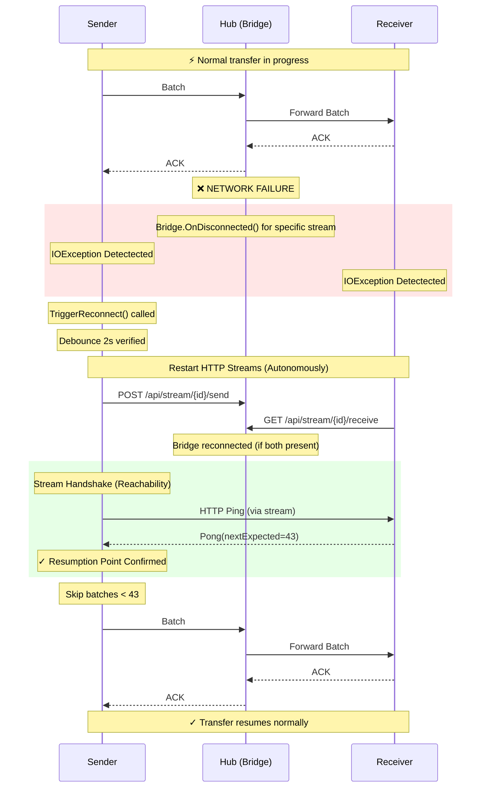
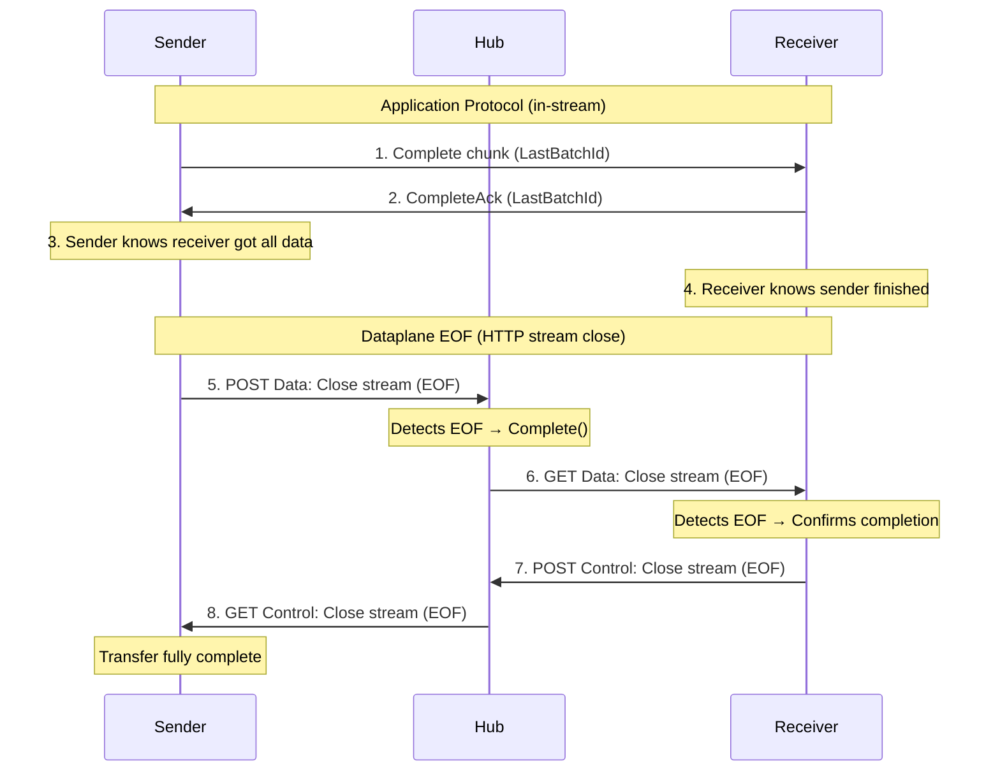
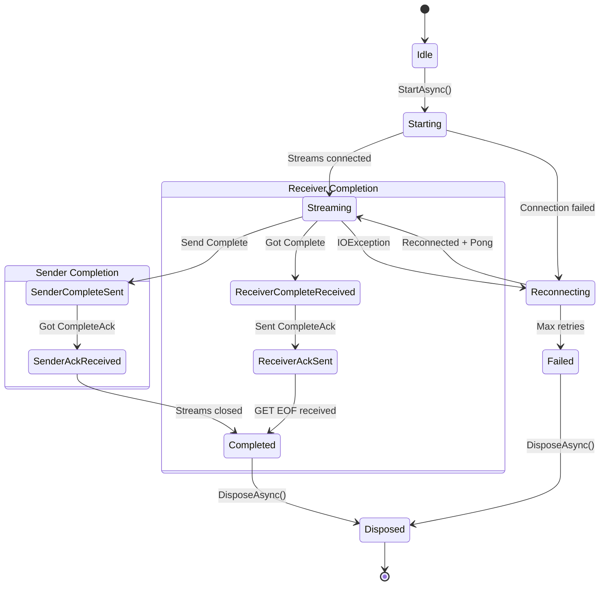

# Resilience & Reachability Architecture

> Technical documentation of TransportR's fault tolerance mechanisms

## Overview

TransportR implements a **"Dataplane First" resilience pattern** where:
1.  **State is driven by streams**: HTTP streams interactions determine the transfer state.
2.  **Reachability via Stream Handshake**: Connections are verified by exchanging Ping/Pong on the data stream itself, not via SignalR.
3.  **Smart Resend**: Stream Handshake tells the sender exactly which batch was last processed (Packet Level Ack), enabling precise resumption without duplicates.
4.  **Hub Lifecycle Management**: The Hub acts as a passive router + active monitor (Reaper), terminating stalled transfers but not orchestrating recovery.

---

## Key Timings

| Component | Delay | Description |
|-----------|-------|---------|
| **Reconnect Debounce** | 2 s | Prevents reconnection spam (Client side) |
| **Pong Wait** | 10 s timeout | HTTP stream Ping/Pong Handshake |
| **HTTP Backoff** | 100 ms → 5 s | Exponential (Restart data streams) |
| **Bridge Timeout** | 300 s | Hub cancels a non-active bridge waiting for a peer (`BridgeTimeoutSeconds`) |
| **Transfer Inactivity** | 60 s | Hub terminates a transfer gone fully silent (`TransferInactivityTimeoutSeconds`) |
| **Stalled Progress** | disabled | Opt-in: alive but not advancing (`StalledProgressTimeoutSeconds`) |

---

## Sequence Diagram: Disconnection & Reconnection



---

## Mechanism Details

### 1. Disconnection Detection (Client-Side)

Both Sender and Receiver rely on standard `IOException` or `HttpRequestException` when reading/writing to the stream.
The Hub **DOES NOT** actively notify clients of disconnections via SignalR (to avoid race conditions).

### 2. Stream Handshake (Reachability & Resume)

Instead of querying the Hub for a "Checkpoint", the Sender asks the Receiver directly **through the new data stream**:

1.  **Sender** sends `ChunkType.Ping` immediately upon connecting the stream.
2.  **Receiver** responds with `ChunkType.Pong`, carrying the `NextExpectedBatchId`.
3.  **Sender** uses this ID to prune its retry buffer.

This ensures that resumption is based on the **Receiver's actual state**, which is the ultimate source of truth.

```csharp
// Sender Logic
await ChunkIO.WriteChunkAsync(stream, pingChunk);
// ... wait for Pong ...
if (pong.NextExpectedBatchId > currentBatch.Id) {
    Skip(currentBatch); // Already received
}
```

### 3. Hub-Driven Timeout (Dead Transfer Cleanup)

The Hub employs a **TransferCleanupService** that monitors all active transfers.

-   **LastActivityUtc**: Updates on Heartbeat (SignalR) or HTTP activity.
-   **LastProgressUtc**: Updates ONLY when `ItemsSent`, `AcksReceived`, `ItemsReceived` or `AcksSent` increases.
-   **Inactivity policy** (`TransferInactivityTimeoutSeconds`, default `60 s`): a transfer with no activity at all — not even a heartbeat — is terminated. Because heartbeats and Ping keep-alives refresh `LastActivityUtc`, this deliberately does **not** fire for a peer that is connected but stuck.
-   **Stalled-progress policy** (`StalledProgressTimeoutSeconds`, default **disabled**): a transfer that is alive but whose counters have not moved is terminated. This is the "Zombie" case (a deadlock or a client issue).
-   **Why the second one is opt-in**: from the hub, a reconnection is indistinguishable from a stall — no progress happens during either. A value at or below the Bridge Timeout would kill transfers that would have recovered, so the deployment has to name the longest outage it intends to survive before enabling it.

### 4. Affinity Handoff (HA)

In a multi-hub deployment behind a load balancer with sticky sessions, the Hub ensures clients connect to the correct instance using `AffinityRedirectException`.

---

## Protocol Chunk Types

| Type | Code | Description |
|------|------|-------------|
| `Batch` | 0x01 | Data payload |
| `BatchAck` | 0x02 | Batch acknowledgment |
| `Complete` | 0x03 | Transfer completion signal |
| `CompleteAck` | 0x04 | Acknowledgment of Complete |
| `Ping` | 0x05 | Stream Handshake Request |
| `Pong` | 0x06 | Stream Handshake Response (+ Resume Offset) |

---

## Transfer Completion: EOF Domino Sequence

TransportR uses **pure dataplane signals** for transfer completion. No SignalR control plane messages are used.

### 8-Step Domino Sequence



### Hub Detection

The Hub detects completion via `CopyAndFlushAsync()` which returns `StreamEndReason.CleanEOF` when the sender closes its POST stream cleanly (Step 5).

```csharp
var endReason = await CopyAndFlushAsync(inputStream, receiverOutput, bufferSize, token);
if (endReason == StreamEndReason.CleanEOF)
{
    bridge.Complete(); // Triggers Step 6
}
```

### Client State Transitions

| State | Sender | Receiver |
|-------|--------|----------|
| Streaming | Normal operation | Normal operation |
| SenderCompleteSent | Sent Complete, waiting ACK | - |
| ReceiverCompleteReceived | - | Got Complete chunk |
| SenderAckReceived | Got CompleteAck | - |
| ReceiverAckSent | - | Sent CompleteAck |
| Completed | All streams closed | All streams closed |

### Why Not Control Plane?

| Approach | Issue |
|----------|-------|
| SignalR `TransferShutdown` | Race condition: message may arrive before/after stream events |
| Explicit `TransferComplete` call | Adds network round-trip, can fail independently |
| **EOF Detection (current)** | Synchronous, guaranteed ordering, no extra messages |

---

## Client State Machine



### State Descriptions

| State | Description |
|-------|-------------|
| `Idle` | Initial state before starting |
| `Starting` | Establishing HTTP streams |
| `Streaming` | Normal data transfer |
| `Reconnecting` | Stream broken, attempting recovery |
| `SenderCompleteSent` | Sender: Complete sent, awaiting ACK |
| `SenderAckReceived` | Sender: Got CompleteAck |
| `ReceiverCompleteReceived` | Receiver: Got Complete chunk |
| `ReceiverAckSent` | Receiver: Sent CompleteAck |
| `Completed` | Transfer finished successfully |
| `Failed` | Unrecoverable error |
| `Disposed` | Session disposed |
