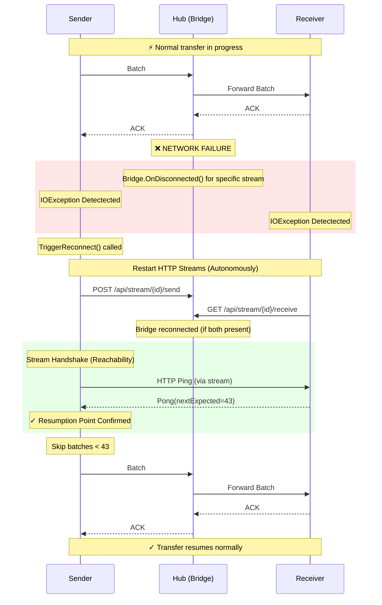
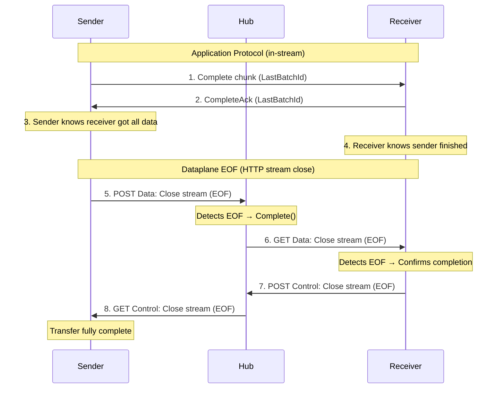
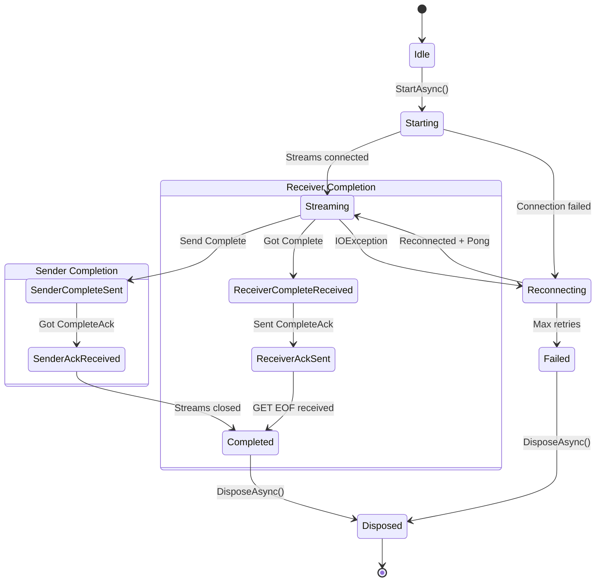

# Resilience & Reachability Architecture

> Technical documentation of TransportR's fault tolerance mechanisms

## Overview

TransportR implements a **"Dataplane First" resilience pattern** where:
1.  **State is driven by streams**: HTTP streams interactions determine the transfer state.
2.  **Reachability via Stream Handshake**: Connections are verified by exchanging Ping/Pong on the data stream itself, not via SignalR.
3.  **Smart Resend**: Stream Handshake tells the sender exactly which batch was last processed (Packet Level Ack), enabling precise resumption without duplicates.
4.  **Hub Lifecycle Management**: The Hub acts as a passive router + active monitor (Reaper), terminating stalled transfers but not orchestrating recovery.

---

## Key Timings

| Component | Delay | Description |
|-----------|-------|---------|
| **Reconnect probe interval** | 2 s | Wait between connectivity probes while a session is `Reconnecting` (hard-coded) |
| **Pong Wait** | 10 s timeout | HTTP stream Ping/Pong Handshake |
| **SignalR connect backoff** | 500 ms → 5 s | Exponential over 5 attempts, on the initial hub connection only (hard-coded). Restarting a data stream is not backed off. |
| **Bridge Timeout** | 300 s | Hub cancels a non-active bridge waiting for a peer (`BridgeTimeoutSeconds`) |
| **Transfer Inactivity** | 60 s | Hub terminates a transfer gone fully silent (`TransferInactivityTimeoutSeconds`) |
| **Stalled Progress** | disabled | Opt-in: alive but not advancing (`StalledProgressTimeoutSeconds`) |

---

## Sequence Diagram: Disconnection & Reconnection



---

## Mechanism Details

### 1. Disconnection Detection (Client-Side)

Both Sender and Receiver rely on standard `IOException` or `HttpRequestException` when reading/writing to the stream.
The Hub **DOES NOT** actively notify clients of disconnections via SignalR (to avoid race conditions).

A write stream sees a cut even when its client has nothing to write because its requests carry
`Expect: 100-continue`; the reason, and what a reverse proxy in front of the hub must accept and forward, are in
"Data Plane Transport: HTTP/1.1" in `TransportRArchitecture.md`.

### 1b. Registration Lifetime (Hub-Side)

A client registration is **not deleted** when its control connection drops: on an unstable network
the same client usually reconnects within seconds under the same `ClientId`, and removing it would
break a transfer that was about to resume. `OnDisconnectedAsync` instead stamps
`DisconnectedAtUtc`, which `GetReceivers` exposes through `ClientInfo`.

-   **Nothing filters on it.** A caller that finds nobody fails outright, whereas a caller that
    tries a dead client simply retries, so hiding a briefly silent client is the worse error.
    Callers with more than one candidate should prefer those with no value set.
-   **`DisconnectedGraceSeconds`** (default `300 s`, matching the Bridge Timeout) is how long a
    dropped registration is kept before eviction. It is the window in which a reconnecting client
    can claim its registration back.
-   **`ConnectedTtlSeconds`** (default `3600 s`) is a backstop for registrations orphaned by a hub
    that died without running `OnDisconnectedAsync`. It applies to stores with server-side expiry
    (Redis); the in-memory store keeps connected registrations for the lifetime of the process.
-   **`Heartbeat()`** is what refreshes it. The client invokes it every
    `PresenceHeartbeatInterval` (default `60 s`) for as long as it is connected, whether or not a
    transfer is running, so an idle client never expires. Keep the interval well below
    `ConnectedTtlSeconds`.

> **The per-transfer heartbeats cannot do this job.** `SenderHeartbeat` / `ReceiverHeartbeat` live
> on `DataSession`, which exists only while a transfer does, and they report transfer statistics
> into `TransferState` — they never touch the registration. Presence is a property of the client,
> not of a transfer.

### 1c. Losing a Registration While Connected

Three things leave a client connected but unknown to the hub: a hub restart, a registration evicted
past its grace period, and a **SignalR reconnection**, which gives the client a new connection id
while the stored registration still names the old one. In all three, discovery returns nothing for
that client and nobody can open a transfer against it — while its own in-flight transfers keep
working, because resumption is entirely data-plane.

Recovery is the client's, and has two paths:

-   `Heartbeat()` returns **`false`** when the hub holds no registration for the calling
    connection. The client answers by invoking `Connect` again.
-   On `Reconnected`, the client re-registers immediately rather than waiting up to a full
    heartbeat interval. This is wired through the connection-rebuild callback, so it survives an
    affinity redirect rebuilding the `HubConnection`.

A `chaos` run shows this firing about ten times over two million rows.

Without this policy the two implementations fail in opposite directions — an in-memory registration
lives forever, and a Redis one expires on a fixed timer whether or not the client is still there.

### 2. Stream Handshake (Reachability & Resume)

Instead of querying the Hub for a "Checkpoint", the Sender asks the Receiver directly **through the new data stream**:

1.  **Sender** sends `ChunkType.Ping` immediately upon connecting the stream.
2.  **Receiver** responds with `ChunkType.Pong`, carrying the `NextExpectedBatchId`.
3.  **Sender** uses this ID to prune its retry buffer.

This ensures that resumption is based on the **Receiver's actual state**, which is the ultimate source of truth.

**A batch is the smallest thing this can name**, so the receiver hands one to its consumer whole or not at all: capacity for every item is taken before the first is published, and the hand-off is not cancellable. A batch stopped half way would raise no `NextExpectedBatchId`, be resent whole, and deliver its published prefix to the consumer twice.

```csharp
// Sender Logic
await ChunkIO.WriteChunkAsync(stream, pingChunk);
// ... wait for Pong ...
if (pong.NextExpectedBatchId > currentBatch.Id) {
    Skip(currentBatch); // Already received
}
```

### 3. Hub-Driven Timeout (Dead Transfer Cleanup)

The Hub employs a **TransferCleanupService** that monitors all active transfers.

-   **LastActivityUtc**: Updates on Heartbeat (SignalR) or HTTP activity.
-   **LastProgressUtc**: Updates ONLY when `ItemsSent`, `AcksReceived`, `ItemsReceived` or `AcksSent` increases.
-   **Inactivity policy** (`TransferInactivityTimeoutSeconds`, default `60 s`): a transfer with no activity at all — not even a heartbeat — is terminated. Because heartbeats and Ping keep-alives refresh `LastActivityUtc`, this deliberately does **not** fire for a peer that is connected but stuck.
-   **Stalled-progress policy** (`StalledProgressTimeoutSeconds`, default **disabled**): a transfer that is alive but whose counters have not moved is terminated. This is the "Zombie" case (a deadlock or a client issue).
-   **Why the second one is opt-in**: from the hub, a reconnection is indistinguishable from a stall — no progress happens during either. A value at or below the Bridge Timeout would kill transfers that would have recovered, so the deployment has to name the longest outage it intends to survive before enabling it.
-   **Not a liveness check**: a transfer whose participant's token ran out, or whose groups may no longer reach each other, is ended by the access sweep instead (see "Token Renewal" in `SecurityArchitecture.md`).

### 4. Affinity Handoff (HA)

In a multi-hub deployment behind a load balancer with sticky sessions, the Hub ensures clients connect to the correct instance using `AffinityRedirectException`.

### 5. Backpressure (Both Ends, Data Plane Only)

A slow consumer must cost the transfer time, not memory. There is no control-plane message for this: the pushback is the data plane throttling itself, end to end, and the hub takes no part in it.

**The chain.** A full receive buffer parks the receiver's read loop. A parked read loop stops draining the HTTP response body, which closes the TCP window back to the hub, which blocks the hub's forwarding write, which blocks the sender's HTTP write. And because a batch is acknowledged only *after* it lands in the receive buffer, the acknowledgement that would reopen the sender's in-flight window is withheld for as long as the consumer is behind. One slow consumer therefore stops the producer, without anyone being told.

**The two bounds, and their units.**

| End | Option | Counts | Default |
|---|---|---|---|
| Sender | `ClientOptions.MaxInFlightBatches` | batches flushed but not yet acknowledged | `null` — unbounded |
| Receiver | `ClientOptions.ReceiveBufferCapacity` | items **and** wire bytes, first to bind | `null` — unbounded |

**Both are opt-in, and that is a decision rather than an omission.** The figure that makes a bound useful depends on how large an item is, which only the caller knows: for record-sized payloads an unbounded buffer is a memory spike, for multi-megabyte ones it is the process. A default would be a guess wearing the costume of a safeguard, and the wrong guess is worse than none because nobody looks for a setting that appears to be handled. `Build()` warns when neither end is set, so the absence is loud rather than silent.

**Out of the box there is therefore no backpressure anywhere**, and a consumer slower than its producer is absorbed in memory until something dies. **Set both ends: either one alone moves the backlog to the other process.** The receiver's bound stops the sender's HTTP write through the chain above, but not its serialization worker, which never waits — serialized batches queue behind the blocked write. Measured: `slow-receiver` holds its receiver at 193 MB while its sender, which it does not assert, peaks at 451 MB; an integration moving Arrow batches reached 1 693 MB on the sender with the receiver bounded alone, and 1 038 MB on the receiver with neither. The send window is what stops the worker, and the receiver's bound is what the window cannot see.

A producer parked on a full window is released only by an acknowledgement, so a receiver that stops early would leave it parked forever. It fails instead, with `TransferFailedException`, once nothing has been acknowledged for `CompleteStallTimeout` — the rule `CompleteAsync` already applies: a peer still acknowledging is still working, however slowly. Both failures send `Abort` (`AcknowledgementTimeout`) before closing the data stream, because that stream closes as cleanly as a finished transfer's and the hub relays it to the receiver as one.

The hub keeps nothing of what it relays, so an `Abort` the receiver never read is gone: its streams restart when the sender's control read ends (the hub cuts the receiver's control write), and the restart discards what was still unread. A data stream whose source has finished is answered `410 Gone`, which the client already reads as the end of the transfer — `Failed`, or `Completed` in the closing phase — rather than as a stream to reopen. A fatal stream failure, this one or a transfer the hub no longer knows, releases a consumer parked in `ReceiveAsync` (it throws `TransferFailedException` once it has taken what was already received) and a producer parked on the window, as an `Abort` does. An `Abort` cannot overtake data the receiver has not read: with the pipe full it is still queued when `AbortWriteTimeout` expires, and only `BridgeTimeoutSeconds` — or `StalledProgressTimeoutSeconds`, where it is set — releases the receiver.

The sender's window is taken **by the producer, before serialization**. Taking it in front of the serialization worker instead would bound the serialized bytes by letting the un-serialized items pile up behind them — which for an off-heap payload such as an Arrow `RecordBatch` converts a managed backlog into a native one, the same symptom in a worse form.

That placement is also why the sender's window cannot count bytes: the serialized size is not known until after the point where the slot is taken. A byte-accurate sender window would need the caller to price an item before it is serialized. It is not needed for the memory to be bounded — with the window set, the receiver's byte bound reaches the sender through the chain above, by withholding the acknowledgements the window waits for.

**Receive capacity is two-dimensional because one unit cannot serve both payload shapes.** Ten thousand items is a memory figure when an item is an order and a meaningless one when it is a multi-megabyte record batch; a byte budget is the reverse. Both are declared and the first one reached binds, so neither kind of payload has to disable the other's bound.

**Bytes are wire bytes** — the serialized payload as it arrived, charged to a chunk before it is decoded and returned item by item as the consumer takes them. It is the only size available without knowing what the item type costs on the heap, and it is not that cost: Arrow IPC bodies are close to their decoded buffers less whatever LZ4 saved, while MessagePack records decode to several times their wire size. Size the bound against that expansion.

**A chunk larger than the whole budget — in either dimension — is still admitted into an empty buffer.** Refusing it would be a permanent stall rather than backpressure, since nothing can ever free room for it, and a chunk cannot be handed over in parts. Lowering either bound therefore throttles a transfer and cannot deadlock one.

---

## Protocol Chunk Types

| Type | Code | Description |
|------|------|-------------|
| `Batch` | 0x01 | Data payload |
| `BatchAck` | 0x02 | Batch acknowledgment |
| `Complete` | 0x03 | Transfer completion signal |
| `CompleteAck` | 0x04 | Acknowledgment of Complete |
| `Ping` | 0x05 | Stream Handshake Request |
| `Pong` | 0x06 | Stream Handshake Response (+ Resume Offset) |
| `Abort` | 0x07 | The sending end gave up; `BatchId` carries an `AbortReason` |

---

## Transfer Completion: EOF Domino Sequence

TransportR uses **pure dataplane signals** for transfer completion. No SignalR control plane messages are used.

### 8-Step Domino Sequence



### Hub Detection

The Hub detects completion via `CopyAndFlushAsync()` which returns `StreamEndReason.CleanEOF` when the sender closes its POST stream cleanly (Step 5).

```csharp
var endReason = await CopyAndFlushAsync(inputStream, receiverOutput, bufferSize, token);
if (endReason == StreamEndReason.CleanEOF)
{
    bridge.Complete(); // Triggers Step 6
}
```

### Client State Transitions

| State | Sender | Receiver |
|-------|--------|----------|
| Streaming | Normal operation | Normal operation |
| SenderCompleteSent | Sent Complete, waiting ACK | - |
| ReceiverCompleteReceived | - | Got Complete chunk |
| SenderAckReceived | Got CompleteAck | - |
| ReceiverAckSent | - | Sent CompleteAck |
| Completed | All streams closed | All streams closed |

### Why Not Control Plane?

| Approach | Issue |
|----------|-------|
| SignalR `TransferShutdown` | Race condition: message may arrive before/after stream events |
| Explicit `TransferComplete` call | Adds network round-trip, can fail independently |
| **EOF Detection (current)** | Synchronous, guaranteed ordering, no extra messages |

---

## Client State Machine



### State Descriptions

| State | Description |
|-------|-------------|
| `Idle` | Initial state before starting |
| `Starting` | Establishing HTTP streams |
| `Streaming` | Normal data transfer |
| `Reconnecting` | Stream broken, attempting recovery |
| `SenderCompleteSent` | Sender: Complete sent, awaiting ACK |
| `SenderAckReceived` | Sender: Got CompleteAck |
| `ReceiverCompleteReceived` | Receiver: Got Complete chunk |
| `ReceiverAckSent` | Receiver: Sent CompleteAck |
| `Completed` | Transfer finished successfully |
| `Failed` | Unrecoverable error |
| `Disposed` | Session disposed |
