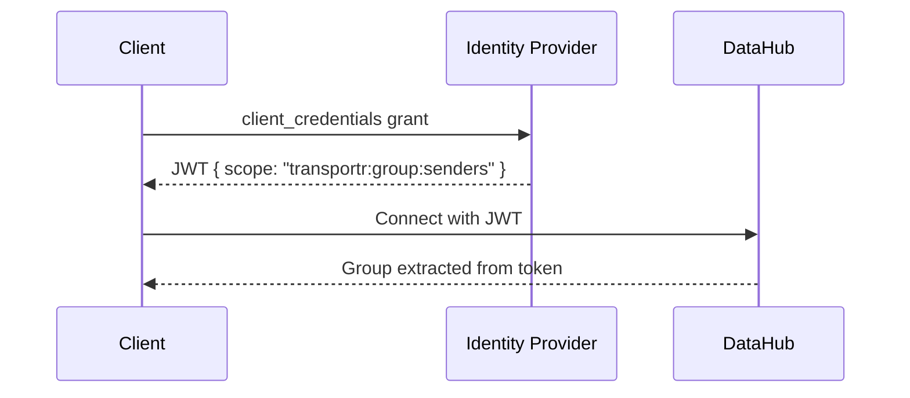
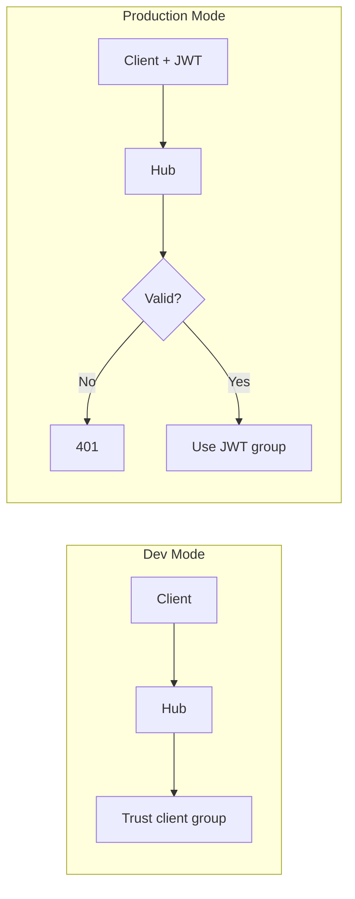

# TransportR Security Architecture

## Overview

TransportR uses **JWT-based authentication** via OAuth 2.0. Groups are derived from token scopes (`transportr:group:*`), preventing spoofing.



---

## Scope Convention

| Scope | Description |
|-------|-------------|
| `transportr:group:senders` | Can initiate transfers |
| `transportr:group:receivers` | Can receive transfers |

The `transportr:` prefix allows coexistence with other apps on a shared IDP.

---

## Security Guarantees

| Threat | Protection |
|--------|------------|
| Unauthenticated access | JWT required when auth enabled |
| Group spoofing | Group from JWT scope only |
| Unauthorized transfer | FlowControl validates permissions |
| Token tampering | Signature verified against IDP |
| Expired tokens | `exp` claim validated |

---

## Token Renewal

- Hub tracks token expiry from `exp` claim
- Client renews automatically 5 minutes before expiry
- `InitTransfer()` rejects expired tokens

---

## Development vs Production Mode



| Variable | Effect |
|----------|--------|
| `EnableAuth=false` | Dev mode (default) |
| `EnableAuth=true` | JWT enforced |

---

## TestIdp (Development)

Minimal IDP in `samples/TestIdp` for local testing:

| ClientId | Secret | Scope |
|----------|--------|-------|
| `sender` | `sender-secret` | `transportr:group:senders` |
| `receiver` | `receiver-secret` | `transportr:group:receivers` |

Run: `dotnet run --project samples/TestIdp`

---

## Using External IDP

1. Register scopes: `transportr:group:senders`, `transportr:group:receivers`
2. Create clients with appropriate scopes
3. Configure:
   ```bash
   export EnableAuth=true
   export Oidc__Authority=https://your-idp.example.com
   ```

---

## Benchmark Scripts

| Command | Auth |
|---------|------|
| `./scripts/run-benchmark.sh` | ❌ |
| `./scripts/run-benchmark.sh oidc` | ✅ |
