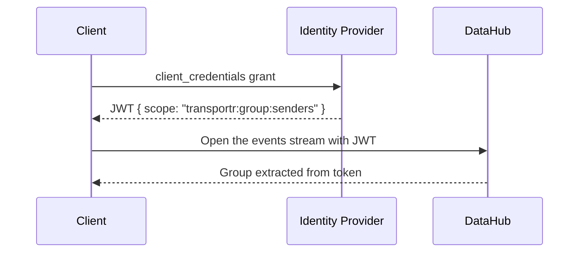
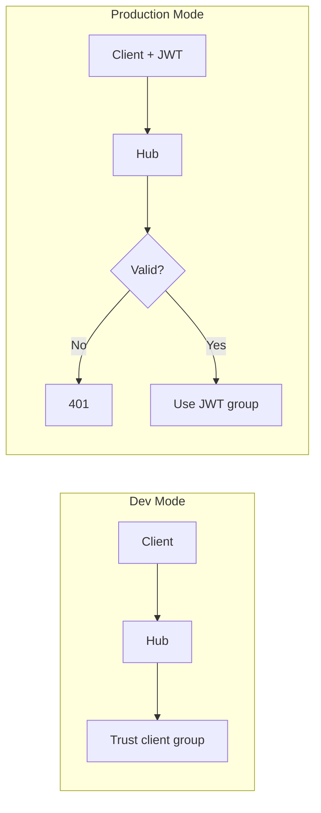

# TransportR Security Architecture

## Overview

TransportR uses **JWT-based authentication** via OAuth 2.0. Groups are derived from token scopes (`transportr:group:*`), preventing spoofing.



---

## Scope Convention

Each `transportr:group:<name>` scope puts the client in group `<name>`. The hub reads the `scope` claim in
either shape an issuer gives it, a space-delimited string or an array, and ignores scopes without the prefix,
which allows coexistence with other apps on a shared IDP. A provider that carries rights in another claim
(Entra ID app roles, for instance) needs the host's own `IClientIdentityProvider`.

A group name carries no right by itself: `senders` and `receivers` are the names the samples use, and what
one group may do to another is the flow control rule below.

---

## Group Access Rules (Flow Control)

**Without an `IFlowControlService`, any client holding a group may open a transfer to any other client holding
one.** `AddDataHub()` registers none; the host adds the rules:

```csharp
builder.Services.AddSingleton(new FlowControlOptions
{
    Groups = new()
    {
        ["senders"]   = new GroupAccess { CanSendTo = ["receivers"] },
        ["receivers"] = new GroupAccess { CanSendTo = [] },
    }
});
builder.Services.AddSingleton<IFlowControlService, DefaultFlowControlService>();
```

A source may reach a target when, for **every** group of the target, one of the source's groups lists it (or
`"*"`). The same rule filters `GetReceivers`, admits `InitTransfer`, and is re-applied to running transfers by
the access sweep (see Token Renewal).

A host that opens every transfer itself sets `AccessOptions.ClientsMayOpenTransfers` to `false`: a client is then
refused `GetReceivers` and `InitTransfer`, and transfers open only through `ITransferInitiator`.

---

## Security Guarantees

Both planes are stated separately, because they are armed separately.

| Threat | Protection |
|--------|------------|
| Unauthenticated access to the control plane | JWT required when auth enabled |
| Unauthenticated access to the data plane | JWT required when auth enabled; **open in dev mode** |
| A third party streaming into or out of a transfer, or ending it (`POST /api/stream/{id}/abort`) | The caller's token subject must match a participant that registered, checked when a write stream opens (a WebSocket's upgrade, or an epoch's first segment); each later segment must come from the identity that opened its epoch |
| A write-transport probe announced in another client's name (`/api/stream/probe/send`) | A route with no transfer, admitted as the client registered on the events stream its `connection` names, by the presence heartbeat's rule: the token must attest that client's id and subject; in dev mode the registration suffices |
| A client acting under another's id on the control plane | On every control route the `clientId` of the path must be the identity the request's token attests; refused with a 404 otherwise |
| Group spoofing | Group from JWT scope only |
| Unauthorized transfer | The flow control rules, when the host registers them; without them any group reaches any other |
| Token tampering | Signature verified against IDP |
| Expired tokens | `exp` validated by the host on each request, each segment of a write stream included, and when a stream opens, a WebSocket's upgrade among them; judged by the hub for as long as it runs (see Token Renewal) |

A write stream carried by a WebSocket is admitted once, at its upgrade, as a read GET is: no later request checks its
token again. Its expiry is the access sweep's to judge (see Token Renewal), which ends the transfer.

In dev mode the data plane serves anyone who knows a transfer id, and lets them end it: there is no attested identity to
compare, so the participant check does not run. The control routes are the same: the `clientId` of the path is compared
with nothing. That is the same trust as the rest of dev mode, where the hub believes the group a client announces.

The participant check is only as fine-grained as the subject the IdP attests. Two processes sharing
one set of client credentials share one subject, and so can take each other's place in a transfer;
they cannot take the other role's place. Issue one IdP client per participant to separate them.

`POST /api/stream/{id}/abort` is armed as the two stream routes are. `MapDataHub()` puts the default
authorization policy on `StreamController` of a hub that validates tokens, so a caller without a valid token
gets a 401; only an explicit `requireAuth: false` leaves it off, with a warning when the hub starts. Past
that the route admits either participant of the transfer, by the checks the streams use, and answers 404 to
anyone else: a transfer the hub does not know, a subject that is not a participant's, and a token that
grants no `transportr:group:*` scope, even when its subject is a participant's. A host that lists its
routes, filters them or allow-lists them in a proxy adds it to the ones it keeps for `send` and `receive`.

---

## Token Renewal

A client keeps the hub holding a token that has not run out, and the hub closes what is not renewed.

- **What the hub holds.** Opening the events stream records the token's `exp`, its groups and its subject. A
  stream's principal is fixed when it opens, so the stream cannot carry a newer token. The requests the client
  makes meanwhile each carry the token it holds then; the hub records a newer one from the renewal below, or from a
  stream opened afterwards.
- **The client renews ahead of the expiry**, on its own clock: `min(TokenRefreshThreshold, half of what is left)`
  before it (5 minutes by default; `WithTokenRefreshThreshold`). It asks its token provider for a new token and
  presents it with `PUT /api/client/{clientId}/token` (`Authorization: Bearer`). The host's authentication
  validates it as it does a data stream; the hub records the groups and the expiry it carries and answers with the
  expiry it recorded, which is what the next renewal is armed on when the client cannot read its own token
  (an encrypted or opaque one). A failed attempt keeps the old token and is retried, with growing and jittered
  delays, until the expiry; a provider that hands back the token it gave before (a caching one) is asked again.
  The first renewal presents the token held just after `ConnectAsync` returns: a right the host withdraws in
  between is applied by it, and a withdrawal that leaves no group closes the stream then.
- **A host can ask for it now.** `RefreshRegistrationAsync()` registers the client again with the groups its
  identity holds at that moment and a token the provider gives now, and returns once the hub has recorded both. It
  is for a host whose own `IClientIdentityProvider` reads rights that change: the hub writes a client's groups when
  it registers and when it renews, and a client that does neither keeps the groups it had. The client opens a new
  stream with the fresh token, closes the old one once the new one is registered, and, with a token provider,
  presents that token as a renewal. It stays reachable throughout, and a question the hub asked on the old stream
  is still answered. Its transfers stay up, and the renewal's reconciliation ends those the new groups no longer
  allow. An identity that holds no group is refused as it is anywhere else, and the registration stays as it was.
- **Refusals are 404**, as on the data plane: no such registration, a token of another subject, a token already
  past its expiry on the hub's clock. Every 404 the hub answers itself, on either plane, carries
  `TransportR-Refused: 1` (`WireRoutes.RefusedHeader`), the same whatever the reason. A 404 without it came from no
  TransportR route, a proxy that does not route the path or a wrong base URL: on the control plane and in the probe
  before a reconnection, the client raises `HttpRequestException` for it rather than report a refusal. A valid token
  of the registered subject that carries no `transportr:group:*` scope is not a refusal: it withdraws every right,
  and is applied.
- **Fail closed.** `AccessSweepService` re-judges every registered client every `AccessSweepIntervalSeconds`
  (5). A client whose token has run out (plus `TokenExpiryMarginSeconds`, 0 by default) has its transfers ended,
  so that it and its peer are told, and then its events stream closed, with a warning that no renewal was received.
  A transfer whose groups the flow control service no longer lets reach each other ends too. The same pass runs
  after each renewal, so groups follow the token, and when the host calls `IAccessReconciler`, which is how a host
  that changes its own policy applies a withdrawal to what is already running without waiting for anyone. A host
  that owns the groups of its clients and runs the hub writes them first, for each registration of the subject
  (`IStateStore.RenewClientAsync`, which leaves the stream alone), then reconciles that client: a group the
  flow control no longer lets through ends the transfers it carried and keeps the stream; none left ends all
  of them and closes the stream, and the client that comes back is refused while its identity holds none.
- **The client comes back.** A stream the hub closes is opened again by the client, with jittered, capped
  delays and no limit, and each opening registers it. Opening it takes a token from the provider when the one held
  is near its expiry, as it is after one ran out, so while the identity provider is down the client stays out.
- **Dev mode** has no token: nothing expires and nothing is closed.

For a deployment:

- Update the hub and its clients together. A client without renewal (0.2.0) is closed at its token's expiry and
  does not come back.
- A reverse proxy that filters by path must let `/api/client/*` through as it does `/api/stream/*`: it carries the
  events stream and every control request as well as the renewal. With the renewal alone held back, every stream
  closes at its token's expiry.
- A static token (`WithAccessToken`) cannot be renewed: its client is closed at the expiry, and says so when it connects.
- The identity provider may be out of reach for as long as the renewal advance without any effect. Past that,
  streams close as their tokens expire, and a client cannot open one again until the provider answers.
- The margin governs the hub's own decisions. Opening a stream or sending a request is judged by the host's JwtBearer
  middleware against its own `ClockSkew`, so a margin beyond that keeps open what is open and admits nothing new.
- A token is a bearer token: an older one that has not expired can be presented again, and a right withdrawn at the
  identity provider reaches the hub as fast as tokens are renewed. A withdrawal decided by the host does not wait:
  see `IAccessReconciler`.

---

## Development vs Production Mode



`EnableAuth` is read by `samples/DataHub`, not by the library. Its effect:

| Variable | Effect |
|----------|--------|
| `EnableAuth=false` | Dev mode (default) |
| `EnableAuth=true` | JWT enforced |

---

## TestIdp (Development)

Minimal IDP in `samples/TestIdp` for local testing:

| ClientId | Secret | Scope |
|----------|--------|-------|
| `sender` | `sender-secret` | `transportr:group:senders` |
| `receiver` | `receiver-secret` | `transportr:group:receivers` |

Run: `dotnet run --project samples/TestIdp`

---

## Using External IDP

1. Register scopes: `transportr:group:senders`, `transportr:group:receivers`
2. Create clients with appropriate scopes
3. Configure `samples/DataHub` with:
   ```bash
   export EnableAuth=true
   export Oidc__Authority=https://your-idp.example.com
   ```

---

## Benchmark Scripts

| Command | Auth |
|---------|------|
| `./scripts/run-benchmark.sh` | ❌ |
| `./scripts/run-benchmark.sh oidc` | ✅ |
