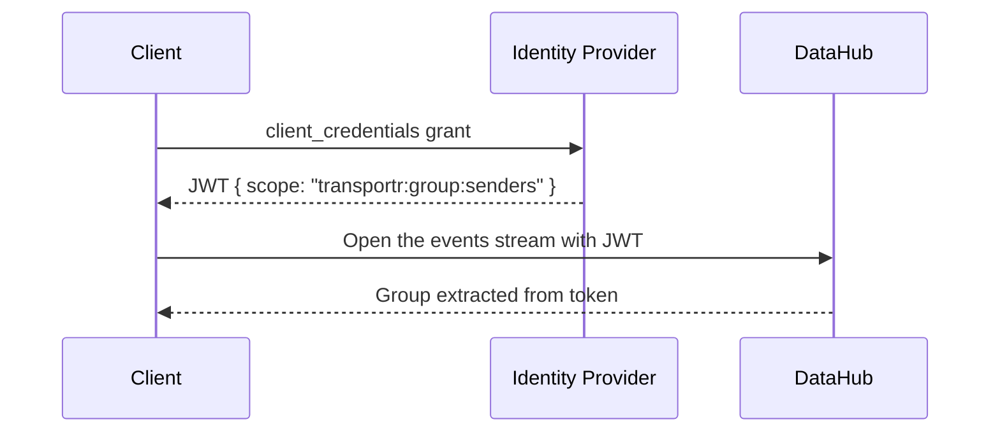
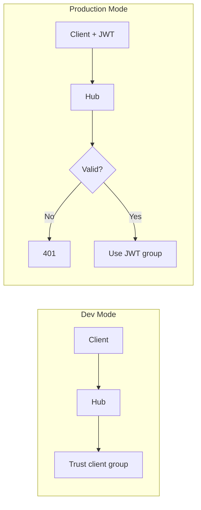

# TransportR Security Architecture

## Overview

TransportR uses **JWT-based authentication** via OAuth 2.0. Groups are derived from token scopes (`transportr:group:*`), preventing spoofing.



---

## Scope Convention

Each `transportr:group:<name>` scope puts the client in group `<name>`. The hub reads the `scope` claim in
either shape an issuer gives it, a space-delimited string or an array, and ignores scopes without the prefix,
which allows coexistence with other apps on a shared IDP. A provider that carries rights in another claim
(Entra ID app roles, for instance) needs the host's own `IClientIdentityProvider`.

A group name carries no right by itself: `senders` and `receivers` are the names the samples use, and what
one group may do to another is the flow control rule below.

---

## Group Access Rules (Flow Control)

**Without an `IFlowControlService`, any client holding a group may open a transfer to any other client holding
one.** `AddDataHub()` registers none. `UseFlowControl` adds the rules; a host with rules of its own registers its own
`IFlowControlService` instead, and the one registered last serves:

```csharp
builder.Services.AddDataHub().UseFlowControl(rules =>
{
    rules.Groups["senders"]   = new GroupAccess { CanSendTo = ["receivers"] };
    rules.Groups["receivers"] = new GroupAccess { CanSendTo = [] };
});
```

A source may reach a target when, for **every** group of the target, one of the source's groups lists it (or
`"*"`). Group names compare as written, case included, here as everywhere else. The same rule filters
`GetReceivers`, admits `InitTransfer`, and is re-applied to running transfers by the access sweep (see Token
Renewal).

`AccessOptions.ClientsMayOpenTransfers = false` reserves opening transfers to the host ("Transfers the host opens" in
`src/TransportR.Hub/README.md`).

---

## Security Guarantees

Each plane has rows of its own, because each is armed on its own.

| Threat | Protection |
|--------|------------|
| Unauthenticated access to the control plane | JWT required when auth enabled |
| Unauthenticated access to the data plane | JWT required when auth enabled; **open in dev mode** |
| A third party streaming into or out of a transfer, or ending it (`POST /api/stream/{id}/abort`) | The token's subject must be a registered participant's, checked when a write stream opens (a WebSocket's upgrade, an epoch's first segment); each later segment must come from the identity that opened its epoch |
| A write-transport probe announced in another client's name (`/api/stream/probe/send`) | The token must attest the id and subject of the client registered on the events stream that `connection` names, as for the presence heartbeat; in dev mode the registration suffices |
| A client acting under another's id on the control plane | On every control route the `clientId` of the path must be the identity the request's token attests; refused with a 404 otherwise |
| Group spoofing | Group from JWT scope only |
| Unauthorized transfer | The flow control rules, when the host registers them (*Group Access Rules*) |
| Learning from a refused transfer which clients exist, or in what state | One message and one category (`Refused`) for a target that is unknown, out of the caller's reach or gone; the hub's log says which |
| Token tampering | Signature verified against IDP |
| An authenticated client flooding `InitTransfer` | Per-client ceilings on the transfers it opens itself (`AccessOptions.MaxHandshakesPerClient`, `MaxOpenTransfersPerClient`), refused with a 429 before anything is written; values under "Transfers the host opens" in `src/TransportR.Hub/README.md` |
| A client letting its events pile up unread | Its events stream holds at most 1024 unread events: the write that finds it full closes it |
| Expired tokens | `exp` validated by the host on each request (a write stream's segments included) and when a stream opens (a WebSocket's upgrade included); judged by the hub for as long as it runs (*Token Renewal*) |
| The hub, a front end or a capture reading or rewriting the payload | Nothing by default; end-to-end encryption when both ends enable it (see End-to-End Encryption) |

A write stream carried by a WebSocket is admitted once, at its upgrade, as a read GET is: no later request checks its
token again. Expiry is judged by the access sweep instead, which ends the transfers of a client whose token has run
out (*Token Renewal*).

In dev mode the data plane serves anyone who knows a transfer id, and lets them end it: with no attested identity to
compare, the participant check does not run. Nor does the control routes' check: the `clientId` of the path is compared
with nothing. That is the trust of the rest of dev mode, where the hub believes the group a client announces.

The participant check is only as fine-grained as the subject the IdP attests. Two processes sharing
one set of client credentials share one subject, and so can take each other's place in a transfer;
they cannot take the other role's place. Issue one IdP client per participant to separate them.

`POST /api/stream/{id}/abort` is armed as `send` and `receive` are. On a hub that validates tokens, `MapDataHub()` puts
the default authorization policy on the stream routes, so a caller without a valid token gets a 401. Only an explicit
`requireAuth: false` lifts it, with a warning when the hub starts. The route then admits either participant, by the
checks the streams use, and answers 404 to anyone else:

- a transfer the hub does not know;
- a subject that is not a participant's;
- a token that grants no `transportr:group:*` scope, even when its subject is a participant's.

A host that lists its routes, filters them or allow-lists them in a proxy keeps this one with `send` and `receive`.

---

## End-to-End Encryption

Off by default: the payload then crosses the hub in clear, under whatever TLS each hop has, and whoever terminates that
TLS or reads the hub reads it. `WithEndToEndEncryption()` on both ends seals it from one end to the other, and a
pre-shared key (PSK) can be added; the protocol is under "End-to-End Encryption" in
[TransportRArchitecture.md](./TransportRArchitecture.md#end-to-end-encryption).

| Adversary | Encryption alone | With a PSK |
|---|---|---|
| Whoever reads the path: a front end or proxy that terminates TLS, the hub's logs and memory image, a network capture | protected | protected |
| A hub, or whoever runs it, that modifies: substitutes the shares, alters, moves or truncates batches, forges an acknowledgement | **not protected**: the key exchange is not authenticated, and a hub that answers each end with a share of its own reads and rewrites everything | protected: the transfer fails, never a false success |
| A hub that hands a transfer to a node other than the one the sender named, or announces another sender to the receiver | **not protected** | protected: each end binds the two client ids it holds into every key, so the confirmation fails before any batch, whether the PSK is per trust domain or per pair |

- **Without a PSK the protection holds only against whoever reads.** Whoever can rewrite the streams can stand between
  the two ends unseen.
- **Still visible to the hub**: who talks to whom, when, and how much (payload sizes, the `Count` and `BatchId` of each
  header), and its power to cut everything. These metadata are out of reach by nature, and availability cannot be
  protected end to end; nothing is built for either.
- **Forward secrecy**, at both levels: each session draws an ephemeral key pair, erased once the keys are derived, so a
  key taken later, the PSK included, opens no transfer recorded before.
- **A PSK per trust domain** is known to every node of that domain: one of them that also held the hub could stand in
  the middle of the others' transfers. **A PSK per pair** closes that case, at the price of a secret per pair; the
  provider receives the peer's client id to allow either.
- **The PSK comes from each node's own configuration**, never from a coordinator that runs alongside the hub or reaches
  the nodes through the same front end: a key that travels the path it protects protects nothing against whoever holds
  that path.
- **No secret leaves the process.** Neither the PSK nor a derived key appears in a log, an exception message or a
  `ToString`. The session erases its copy of the PSK once the keys are derived, and the keys when it is released; the
  array the provider returned is the provider's, and is left as it is.
- **It does not replace TLS.** The tokens, the control plane and every chunk header still rely on each hop's TLS.
- **No PSK rotation.** Each end tries one key per transfer, never an old and a new one: a key changes on both nodes
  together ("Deploying it" in the client README).
- **Transfers the host opens.** The sender takes the receiver the hub announces. Binding the ids stops a hub that tells
  the two ends different parties, not the host's choice of receiver.

---

## Token Renewal

A client keeps the hub holding a token that has not run out, and the hub closes what is not renewed.

- **What the hub holds.** Opening the events stream records the token's `exp`, its groups and its subject. A
  stream's principal is fixed when it opens, so the stream cannot carry a newer token. The requests the client
  makes meanwhile each carry the token it holds then; the hub records a newer one from the renewal below, or from a
  stream opened afterwards.
- **The client renews ahead of the expiry**, on its own clock: `min(TokenRefreshThreshold, half of what is left)`
  before it (5 minutes by default; `WithTokenRefreshThreshold`).
  1. It asks its token provider for a new token and presents it with `PUT /api/client/{clientId}/token`
     (`Authorization: Bearer`).
  2. The host's authentication validates it as it does a data stream. The hub records its groups and its expiry, and
     answers with that expiry. The client arms the next renewal on it when it cannot read its own token (an encrypted
     or opaque one).
  3. A failed attempt keeps the old token and is retried, with growing and jittered delays, until the expiry. A
     provider that hands back the token it gave before (a caching one) is asked again.

  The first renewal presents the token held just after `ConnectAsync` returns. A right the host withdraws in between
  is applied by it, and a withdrawal that leaves no group closes the stream then.
- **A host can ask for it now**, with `RefreshRegistrationAsync()`; its use and its failures are under "Authentication"
  in `src/TransportR.Client/README.md`. The hub writes a client's groups only when it registers and when it renews, so
  a client that does neither keeps the groups it had. The refresh opens a new stream with the fresh token, closes the
  old one once the new one is registered and, with a token provider, presents that token as a renewal. A question the
  hub asked on the old stream is still answered. The renewal's reconciliation ends the transfers the new groups no
  longer allow.
- **Refusals are 404**, as on the data plane: no such registration, a token of another subject, a token already
  past its expiry on the hub's clock.
  - Every 404 the hub answers itself, on either plane, carries `TransportR-Refused: 1` (`WireRoutes.RefusedHeader`),
    the same whatever the reason.
  - A 404 without it came from no TransportR route: a proxy that does not route the path, or a wrong base URL. On the
    control plane and in the probe before a reconnection, the client raises `HttpRequestException` for it rather than
    report a refusal.
- **A token without a group scope is not a refusal.** A valid token of the registered subject that carries no
  `transportr:group:*` scope withdraws every right, and is applied.
- **Fail closed.** `AccessSweepService` judges every registered client again every `AccessSweepIntervalSeconds` (5 s),
  and after each renewal, so groups follow the token. The same pass runs when the host calls `IAccessReconciler`: a
  host that changes its own policy thus applies a withdrawal to what is already running, without waiting for anyone.
  - **Token run out** (plus `TokenExpiryMarginSeconds`, 0 by default): the client's transfers end, so that it and its
    peer are told, then its events stream closes, with a warning that no renewal was received.
  - **A transfer whose groups the flow control no longer lets reach each other**: it ends; the stream stays.
  - **No group left**: every transfer ends, the stream closes, and the client that comes back is refused while its
    identity holds none.

  A host that owns its clients' groups and runs the hub writes them first (`IStateStore.RenewClientAsync`, for each
  registration of the subject), then reconciles the client.
- **The client comes back.** A stream the hub closes is opened again by the client, with jittered, capped
  delays and no limit, and each opening registers it. Opening it takes a token from the provider when the one held
  is near its expiry, as it is after one ran out, so while the identity provider is down the client stays out.
- **Dev mode** has no token: nothing expires and nothing is closed.

For a deployment ("Deploying the hub" in `src/TransportR.Hub/README.md` has the rest, a front end included):

- A static token (`WithAccessToken`) cannot be renewed: its client is closed at the expiry, and says so when it connects.
- The identity provider may be out of reach for as long as the renewal advance without any effect. Past that,
  streams close as their tokens expire, and a client cannot open one again until the provider answers.
- The margin governs the hub's own decisions. Opening a stream or sending a request is judged by the host's JwtBearer
  middleware against its own `ClockSkew`, so a margin beyond that keeps open what is open and admits nothing new.
- A token is a bearer token: an older one that has not expired can be presented again, and a right withdrawn at the
  identity provider reaches the hub as fast as tokens are renewed. A withdrawal decided by the host does not wait:
  see `IAccessReconciler`.

---

## Development vs Production Mode



`UseDevMode()` is the diagram's dev mode, for development only. `samples/DataHub` picks a mode with `EnableAuth`, which
the library does not read, and names its identity provider with `Oidc__Authority` (its README). `samples/TestIdp`
(`dotnet run --project samples/TestIdp`) is a minimal IdP for local testing, whose clients its `appsettings.json` seeds.
The `default` scenario runs in dev mode, and `oidc` against the TestIdp (`scripts/README.md`).
