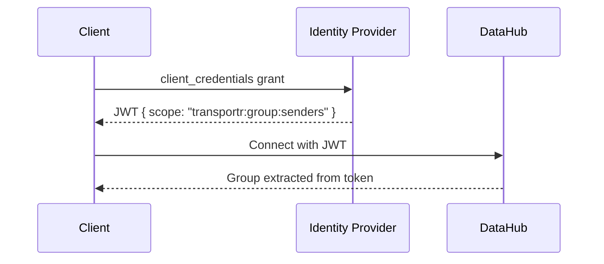
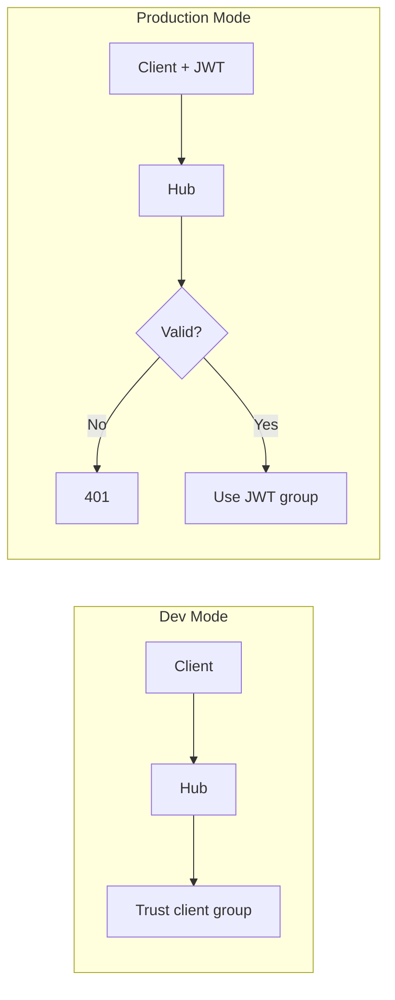

# TransportR Security Architecture

## Overview

TransportR uses **JWT-based authentication** via OAuth 2.0. Groups are derived from token scopes (`transportr:group:*`), preventing spoofing.



---

## Scope Convention

| Scope | Description |
|-------|-------------|
| `transportr:group:senders` | Can initiate transfers |
| `transportr:group:receivers` | Can receive transfers |

The `transportr:` prefix allows coexistence with other apps on a shared IDP.

---

## Security Guarantees

Both planes are stated separately, because they are armed separately.

| Threat | Protection |
|--------|------------|
| Unauthenticated access to the control plane | JWT required when auth enabled |
| Unauthenticated access to the data plane | JWT required when auth enabled; **open in dev mode** |
| A third party streaming into or out of a transfer, or ending it (`POST /api/stream/{id}/abort`) | The caller's token subject must match a participant that registered |
| Group spoofing | Group from JWT scope only |
| Unauthorized transfer | FlowControl validates permissions |
| Token tampering | Signature verified against IDP |
| Expired tokens | `exp` validated by the host when a connection or a stream opens; judged by the hub for as long as it runs (see Token Renewal) |

In dev mode the data plane serves anyone who knows a transfer id, and lets them end it: there is no attested identity to
compare, so the participant check does not run. That is the same trust as the rest of dev mode,
where the hub believes the group a client announces.

The participant check is only as fine-grained as the subject the IdP attests. Two processes sharing
one set of client credentials share one subject, and so can take each other's place in a transfer;
they cannot take the other role's place. Issue one IdP client per participant to separate them.

---

## Token Renewal

A client keeps the hub holding a token that has not run out, and the hub closes what is not renewed.

- **What the hub holds.** `Connect` records the token's `exp`, its groups and its subject. A connection's
  principal is fixed when it opens, so nothing sent over an open connection can carry a newer token.
- **The client renews ahead of the expiry**, on its own clock: `min(TokenRefreshThreshold, half of what is left)`
  before it (5 minutes by default; `WithTokenRefreshThreshold`). It asks its token provider for a new token and
  presents it with `PUT /api/client/{clientId}/token` (`Authorization: Bearer`). The host's authentication
  validates it as it does a data stream; the hub records the groups and the expiry it carries and answers with the
  expiry it recorded, which is what the next renewal is armed on when the client cannot read its own token
  (an encrypted or opaque one). A failed attempt keeps the old token and is retried, with growing and jittered
  delays, until the expiry; a provider that hands back the token it gave before (a caching one) is asked again.
- **A host can ask for it now.** `RefreshRegistrationAsync()` registers the client again with the groups its
  identity holds at that moment and a token the provider gives now, and returns once the hub has recorded both. It
  is for a host whose own `IClientIdentityProvider` reads rights that change: the hub writes a client's groups when
  it registers and when it renews, and a client that does neither keeps the groups it had. The connection and the
  transfers stay up; the renewal's reconciliation ends those the new groups no longer allow. `Connect` over the
  connection that already holds the registration keeps its groups and its expiry when the expiry is later than the
  principal's (the principal is the token the connection opened with, and says nothing of a renewal since), and
  refuses an identity that holds no group as it does anywhere else.
- **Refusals are 404**, as on the data plane: no such registration, a token of another subject, a token already
  past its expiry on the hub's clock. A valid token of the registered subject that carries no
  `transportr:group:*` scope is not a refusal: it withdraws every right, and is applied.
- **Fail closed.** `AccessSweepService` re-judges every registered client every `AccessSweepIntervalSeconds`
  (5). A client whose token has run out (plus `TokenExpiryMarginSeconds`, 0 by default) has its transfers ended,
  so that it and its peer are told, and then its connection closed, with a warning that no renewal was received.
  A transfer whose groups the flow control service no longer lets reach each other ends too. The same pass runs
  after each renewal, so groups follow the token, and when the host calls `IAccessReconciler`, which is how a host
  that changes its own policy applies a withdrawal to what is already running without waiting for anyone. A host
  that owns the groups of its clients and runs the hub writes them first, for each registration of the subject
  (`IStateStore.RenewClientAsync`, which leaves the connection alone), then reconciles that client: a group the
  flow control no longer lets through ends the transfers it carried and keeps the connection; none left ends all
  of them and closes the connection, and the client that comes back is refused while its identity holds none.
- **The client comes back.** A connection the hub closes is started again by the client, with jittered, capped
  delays and no limit, and registers on it again. Starting it asks the provider for a token, so while the
  identity provider is down the client stays out.
- **Dev mode** has no token: nothing expires and nothing is closed.

For a deployment:

- Update the hub and its clients together. A client without renewal (0.2.0) is closed at its token's expiry and
  does not come back.
- A reverse proxy that filters by path must let `/api/client/*` through as it does `/api/stream/*`. Blocked, every
  connection closes at its token's expiry.
- A static token (`WithAccessToken`) cannot be renewed: its client is closed at the expiry, and says so when it connects.
- The identity provider may be out of reach for as long as the renewal advance without any effect. Past that,
  connections close as their tokens expire, and a client cannot start again until the provider answers.
- The margin governs the hub's own decisions. Opening a connection or a stream is judged by the host's JwtBearer
  middleware against its own `ClockSkew`, so a margin beyond that keeps open what is open and admits nothing new.
- A token is a bearer token: an older one that has not expired can be presented again, and a right withdrawn at the
  identity provider reaches the hub as fast as tokens are renewed. A withdrawal decided by the host does not wait:
  see `IAccessReconciler`.

---

## Development vs Production Mode



`EnableAuth` is read by `samples/DataHub`, not by the library. Its effect:

| Variable | Effect |
|----------|--------|
| `EnableAuth=false` | Dev mode (default) |
| `EnableAuth=true` | JWT enforced |

---

## TestIdp (Development)

Minimal IDP in `samples/TestIdp` for local testing:

| ClientId | Secret | Scope |
|----------|--------|-------|
| `sender` | `sender-secret` | `transportr:group:senders` |
| `receiver` | `receiver-secret` | `transportr:group:receivers` |

Run: `dotnet run --project samples/TestIdp`

---

## Using External IDP

1. Register scopes: `transportr:group:senders`, `transportr:group:receivers`
2. Create clients with appropriate scopes
3. Configure `samples/DataHub` with:
   ```bash
   export EnableAuth=true
   export Oidc__Authority=https://your-idp.example.com
   ```

---

## Benchmark Scripts

| Command | Auth |
|---------|------|
| `./scripts/run-benchmark.sh` | ❌ |
| `./scripts/run-benchmark.sh oidc` | ✅ |
