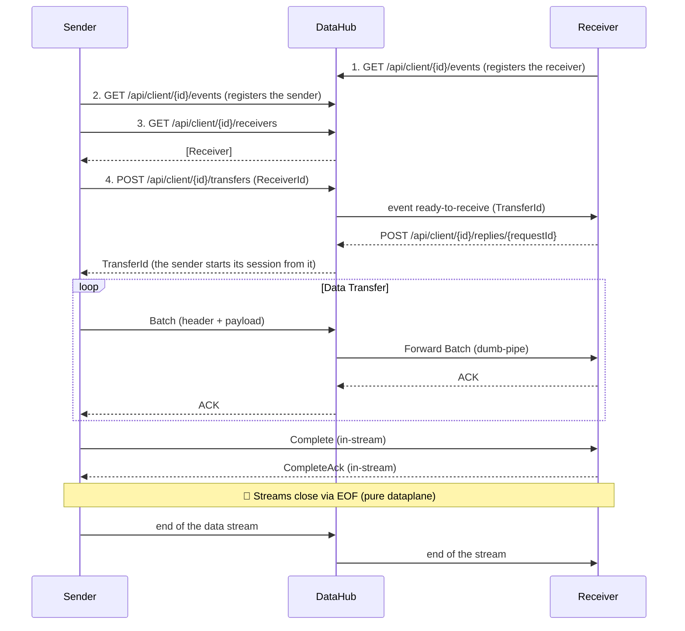

# TransportR - Architecture Overview

> Bulk data transfer through a centralized hub for segmented network environments.

---

## Overview

**TransportR** transfers bulk data between applications through a central hub. Its primary value is simplifying network topology: instead of N×M direct connections, all clients connect only to the hub (N+M connections).

### Core Projects

```
TransportR/                              # Shared contract: routes, client description, write transport
TransportR.Client/                       # Control requests, event stream and HTTP streaming client & OAuth2 auth
TransportR.Hub/                          # HTTP API server (control and data planes) & group flow control
TransportR.Serialization.MessagePack/    # MessagePack + Lz4 serializer
TransportR.Serialization.Json/           # System.Text.Json + Zstd serializer (uncompressed for debugging)
TransportR.Serialization.Arrow/          # Apache Arrow RecordBatch serializer
TransportR.Auth.SimpleIdp/               # Lightweight Identity Provider (dev/test)
TransportR.Storage.Redis/                # Redis State Store implementation
```

### Key Characteristics

| Aspect | Description |
|--------|-------------|
| **Network Simplification** | Single ingress point for all transfers |
| **Dumb Pipe Architecture** | Hub forwards variable-length opaque bytes without deserialization |
| **Reliable Delivery** | Packet-level ACK with automatic retry |
| **Group-based Access** | Groups taken from token scopes decide which client may send to which |
| **Observability** | Hub-side byte counting and write transports via `IHubProgressMonitor` |

---

## Detailed Architecture

### Data Flow



> **Note**: Transfer completion uses pure dataplane signals (the end of a stream), not the control plane.
> See [ResilienceArchitecture.md](./ResilienceArchitecture.md#transfer-completion-eof-domino-sequence) for details.

### Control Plane vs Data Plane

TransportR clearly separates responsibilities between coordination and transfer:

1. **Control Plane (HTTP requests and server-sent events)**
    - **Role**: "The Coordinator"
    - **Methods**: a client opens `GET /api/client/{id}/events`, a stream of server-sent events by which the hub reaches it, and asks the hub for the rest with ordinary requests under the same path (see *Communication Channels*)
    - **Responsibility**: Manages presence, lightweight signaling, and state synchronization. It negotiates the transfer parameters but never touches the bulk data.

2. **Data Plane (HTTP Streaming)**
    - **Role**: "The Pipe"
    - **Methods**: `GET` (a WebSocket) or `POST` (segments) `/api/stream/{id}/send`, `GET /api/stream/{id}/receive`, `POST /api/stream/{id}/abort` for the one case a stream cannot carry ("6. The Abort Request" in `ResilienceArchitecture.md`), and `/api/stream/probe/send` for the write-transport probe (below)
    - **Responsibility**: Moves batches of data. The **Hub** acts as a **Dumb Pipe**, forwarding opaque binary chunks from Sender to Receiver without inspecting or deserializing the payload.

### Communication Channels

| Channel | Transport | Usage |
|---------|-----------|-------|
| **Control plane: events** | HTTP GET, server-sent events (`/api/client/{id}/events`) | Hub → Client. Opening it registers the client and its end marks the client disconnected. Events: `registered` (first, at once), `keepalive`, `ready-to-receive`, `request-send`, `cancel-transfer` |
| **Control plane: requests** | HTTP (`/api/client/{id}/…`) | Client → Hub: `GET receivers` (discovery), `POST transfers` (open a transfer), `POST replies/{requestId}` (answer to an event that asks), `POST presence/{connectionId}`, `POST transfers/{transferId}/heartbeat`, `POST transfers/{transferId}/ping` (the probe before a session reopens its streams) |
| **Data Send** | WebSocket (`GET /api/stream/{id}/send`), or HTTP POST, one segment per request (`POST` on the same path); Header: `X-Connection-Type: Data` | Sender → Hub |
| **Data Receive** | HTTP GET (`/api/stream/{id}/receive`, Header: `X-Connection-Type: Data`) | Hub → Receiver |
| **Control Send** | WebSocket or HTTP POST segments, as Data Send (Header: `X-Connection-Type: Control`) | ACKs Receiver → Hub |
| **Control Receive** | HTTP GET (Header: `X-Connection-Type: Control`) | ACKs Hub → Sender |
| **Abort request** | HTTP POST (`/api/stream/{id}/abort`) | Participant → Hub, when its in-stream `Abort` cannot be written; the hub ends the transfer ("6. The Abort Request" in `ResilienceArchitecture.md`) |
| **Token renewal** | HTTP PUT (`/api/client/{id}/token`) | Client → Hub, ahead of the token's expiry |

Every control request names the client in its path and carries the token the client holds at that moment; with
authentication on, it is refused with a 404 unless the path's `clientId` is the identity that token attests.
The events stream is HTTP/1.1 like the data streams (below), and is relayed as they are ("Deploying the hub" in
`src/TransportR.Hub/README.md`).

### Data Plane Transport: HTTP/1.1, WebSocket or Segments

A write stream, the sender's Data or the receiver's Control, goes over a **WebSocket** (one `GET /api/stream/{id}/send`
with an upgrade) where the path to the hub carries one, and over **segments** (a succession of short
`POST /api/stream/{id}/send` requests) otherwise. The client picks at each opening (`WithWriteTransport`):
`PreferWebSocket`, the default, falls back; `RequireWebSocket` fails the transfer where there is no WebSocket;
`SegmentsOnly` never asks. Read streams are long GETs either way. Above the transport nothing differs (`Ping`/`Pong`,
resumption, the end sequence), and the hub copies the bytes of both unread: what it reads is the transport's own, an
epoch and an offset, a WebSocket's probe and `Close` status.

**The write-transport probe** (`WithWriteTransportProbe()`, off by default) has a client open, in the background after
each registration, a write stream of the same form with no transfer behind it (`/api/stream/probe/send`, naming its
events stream in `connection`): a WebSocket and its proof, else an empty `POST`, as the policy allows and judged as an
opening is. The hub announces what reached it, before any transfer (*Observability*). It informs and decides nothing:
each transfer still finds its own transport when its stream opens, and the proof does not see a front end that holds
bytes back after it.

**A WebSocket opens in this order.**

1. The client sends the upgrade with `X-Connection-Type`, the token, the affinity cookie and `heartbeatMs` (the presence
   interval, which every WebSocket announces).
2. The hub answers `426` to a request that is not an upgrade (a front end did not relay it; logged as a warning), `400`
   to an unreadable `X-Connection-Type`, `404` with `TransportR-Refused` to an unknown transfer or a caller who is not
   its participant, `400` to a missing `heartbeatMs` or one under 1 s or from half of `TransferInactivityTimeoutSeconds`
   up; otherwise it accepts. The route brings `UseWebSockets` with it: the host adds nothing to its pipeline.
3. **The proof.** The client sends an empty `Text` message, the hub answers with one, and the upgrade and the proof
   together have 5 s. A front end can accept an upgrade and still hold bytes back; this is the one test of the
   client-hub hop that depends neither on the peer nor on a hub parked on a slow one, and a path that carries it and
   holds bytes back later is not detected by it. The hub reads that message's type and nothing else: the socket then
   carries `Binary` messages only, copied to the bridge unread.
4. **The first byte.** The socket enters the bridge only when it carries one, as an epoch does with its first segment,
   or a side with nothing to say yet would cut its peer's stream at each reconnection of the peer and be cut in turn.
   It replaces the source the bridge holds, a segment epoch included, whose late segments are answered `409`.
5. **The stream.** A flush is one binary message of at most `StreamBufferSize` (512 KB) and waits for no answer: a peer
   that reads slowly fills the socket, which blocks the flush. That is the backpressure. Each end sends a keepalive
   frame every presence interval, with no keepalive timeout, which would abandon a sound stream whenever the hub is
   parked on a slow peer.

**Whatever is neither a verdict of the hub nor a proven WebSocket reads as a path that does not carry one.** `404` with
`TransportR-Refused` and `410` are the transfer gone; `401` renews the token and opens once more. Any other answer than
`101` (a `404` without that header, `200`, `403`, `405`, `421`, `426`, `5xx`), a connection cut before the answer, no
answer within 5 s, and a `101` whose proof goes unanswered or is cut are the path. The client then uses segments until
the session ends, in the same attempt and before the first byte, and says why in its log (a warning) and in
`TransferInfo.WriteTransportFallback`; the next transfer tries a WebSocket again. Under `RequireWebSocket` the transfer
fails instead, with a message that names no path or setting. A path that passes no segment either fails on the first
one, and the session reconnects as after any cut.

A cut of a proven WebSocket is reopened as any cut is (probe, new opening, `Ping`/`Pong`), over a WebSocket again. A path
that cuts every one, on a frame size or a firewall, would have the session reconnect for ever where segments pass:
three cuts in a row, each within 30 s of its opening, read as the path too, and a connection that lives 30 s clears the
count. A refusal is not a cut.

**A WebSocket ends in one of three ways.**

- **Cleanly**: `Close(4000)` in each direction, the client's after its last flush and the hub's once the bridge has
  closed the stream. A private status, because that end retires the transfer: a front end that cuts with a `Close` of
  its own, 1000 or 1001, has to read as the cut it is. The hub reads any other `Close` as a cut.
- **Refused**: `Close(4409)` from the hub, what a `409` says to a segment (the stream was replaced, its peer was lost,
  the transfer is over), read as retryable and refused. It goes at the client's next write, not at once, as a `409`
  does: sent sooner, a client whose peer reconnected would reconnect in turn and cut that peer. A transfer gone is a
  `404` at the reopening, as for an epoch.
- **Cut**: the connection fails, or closes with another status. The client keeps a read pending for this, since a
  `Close` nobody reads leaves its writes succeeding as if nothing had happened.

**Segments** are the fallback, and pass wherever a request does. A front end that buffers a request body holds back the
few bytes a stream ends on, an acknowledgement or a `Pong`, until the request is over; a short request is over at once.
Each segment carries the next bytes of one opening of the stream, its **epoch**, at their **offset** in it (`DataPlane`).
The hub reads the epoch and the offset from the query, never a byte of the body.

- **One segment in flight.** A flush is a segment, of at most `StreamBufferSize` (512 KB). The hub puts the segments
  of an epoch end to end into the stream a bridge copies from and answers one once the peer has it, so a peer that
  reads slowly slows the flushes down. A segment beyond what the hub has taken is refused, nothing is reordered, and
  the hub keeps no byte past the request. A sender's rate is bounded by one segment per round trip.
- **The answer.** `200`: all of the segment reached the peer. `202`: the hub held it for 30 s, a fixed bound under the
  60 s a default nginx allows a request without an answer, and the peer took only part of it; the client sends the
  rest again, in the same epoch, and the hub skips what it relayed already. Both carry `TransportR-Relayed`, how many
  bytes of the epoch have reached the peer. `409`: the hub holds no epoch this segment follows on from (it was
  replaced or is over, or the segment reached an instance other than the one holding it, which is not a `421`: bridges
  are local to an instance); the client opens a new epoch and the session reconnects as after any cut. `401` took
  nothing: the client renews its token and sends the segment again. `404` and `410` are the transfer gone. On any
  refusal, of a segment or a WebSocket, the attempt ends only once its read stream has, 2 s at most: what the hub
  relayed before refusing, a sender's `Abort` for one, is read first.
- **The end.** The last segment carries `final=true` and goes after the `CompleteAck`. The hub answers it once the
  bridge has closed the stream (*Transfer Completion* in `ResilienceArchitecture.md`).

Both transports are HTTP/1.1, and the client says so on every request, an upgrade included (`HttpVersion.Version11`,
`RequestVersionExact`, in `HttpStreamManager`). It is a decision, not a default left alone:

- **HTTP/2 has nothing to offer this traffic.** A participant holds one long GET per transfer and writes on one socket,
  or one request at a time: there is nothing to multiplex and no request header worth compressing.
- **HTTP/2 caps an upload at its flow-control window.** With Kestrel's default windows, one continuous
  sender-to-hub stream reached 16 MB/s at 20 ms round-trip and 4.7 MB/s at 80 ms (h2c, loopback behind a
  latency-injecting TCP proxy). A hub host can raise `Http2.InitialStreamWindowSize`; HTTP/1.1 needs no such tuning.
  That was measured on a continuous upload: segments under HTTP/2 have not been, and a WebSocket over HTTP/2
  (RFC 8441) is excluded.

What this asks of a front end, and the environments it has been validated in, are under "Deploying the hub" in
`src/TransportR.Hub/README.md`.

### Resilience & Reliability

TransportR utilizes a **Dataplane First** resilience strategy:

- **Stream Handshake (Ping/Pong)**: After a cut, the client probes the hub with a request, then reopens its streams once it answers; a Ping/Pong on the new data stream tells the sender where the receiver stands.
- **Packet-Level Resumption**: Receiver names the next batch it expects, the one to resume from, eliminating the need for Hub-side state (Checkpoints).
- **Sender-side Buffering**: Payloads are kept until End-to-End ACK is received.
- **Hub Lifecycle Management**: Hub terminates transfers that go silent (timeout), and, if configured, those that stop progressing.

See [ResilienceArchitecture.md](./ResilienceArchitecture.md) for the complete design.

### Security

Authentication and Authorization are handled via OAuth2/JWT with group-based scoping (`transportr:group:*`).
See [SecurityArchitecture.md](./SecurityArchitecture.md) for the security model.

### High Availability (HA)

TransportR supports horizontal scaling (Active/Active) for Hubs:

1. **Shared State**: Client registrations and transfer sessions are stored in Redis
   (`TransportR.Storage.Redis`) -> Used for registration, discovery and routing.
2. **Sticky Sessions**: Required at the Load Balancer level. A client has an affinity of its own, that of the instance holding its events stream, which its registration, discovery, presence and renewal requests carry. A transfer has another, that of the instance holding its bridge, which its handshake, its replies, its heartbeats, its probe and its data streams carry. The client sets the `Cookie` header request by request, and its HTTP handler holds no cookie container, which would override it.
3. **Affinity Handoff**: A sender whose receiver's events stream is held by another instance is answered `421` with the cookie that reaches that instance, and sends that one `InitTransfer` request again with it. Its own events stream does not move, and neither do its other transfers. A stream opened without a cookie whose response sets one is opened once more carrying it, since the registration would otherwise record no instance.
4. **TestProxy**: A YARP-based reference implementation is provided for testing HA locally; `ha-transfer-affinity` is the scenario that exercises the redirection and the affinity of each transfer.

**What is *not* shared, and why sticky sessions are a requirement rather than an optimisation**:
the per-transfer progress counters (`TransferState`: items sent, acks, last activity) live in a
dictionary local to the hub instance that registered the transfer or accepted one of its streams,
never in `IStateStore`. `TransferCleanupService` kills a transfer on those counters, so a deployment
where a transfer's heartbeats and streams reach different instances gives each one a half-silent
transfer and invites both to reap it. Moving the
counters into Redis would buy a case the deployment already excludes, at the price of a write per
heartbeat — so the constraint is written here instead: **HA requires effective affinity, not merely
preferred affinity.**

---

## Main Interfaces

| Interface | Purpose | Location |
|-----------|---------|----------|
| `IDataSender<T>` | Initiate transfers, discover receivers | [ITransportRClient.cs](src/TransportR.Client/Abstractions/ITransportRClient.cs) |
| `IDataReceiver<T>` | Receive transfers via event | [ITransportRClient.cs](src/TransportR.Client/Abstractions/ITransportRClient.cs) |
| `IBatchSerializer<T>` | Pluggable serialization | [IBatchSerializer.cs](src/TransportR.Client/Abstractions/IBatchSerializer.cs) |
| `IHubProgressMonitor` | Hub-side monitoring (bytes and write transports) | [IHubProgressMonitor.cs](src/TransportR.Hub/Abstractions/IHubProgressMonitor.cs) |

> The hub operates as a "dumb-pipe": it counts bytes and knows how a write stream reached it, never what the chunks hold.

## Observability

**The packages emit no metrics of their own.** Two hooks are provided and the host decides what to
do with them: `IHubProgressMonitor` on the hub side, and the `TransferInfo` records
`GetTransfers()` returns on the client side. `samples/DataHub` builds its own OpenTelemetry meter
on top of the first — copy it rather than expect one from the package. The hub announces the transport
of each write stream it takes on, to its log and to `IHubProgressMonitor.OnWriteStreamOpened`, and of each
write-transport probe to `OnWriteTransportProbed`.

---

## Binary Protocol

### Wire Format (v2)

The transport protocol uses a **30-byte fixed header** followed by an **opaque binary payload**. The payload serialization is completely decoupled via `IBatchSerializer<T>`.

```
┌──────────────────────────────────────────────────────────────┐
│ ChunkHeader (30 bytes fixed)                                 │
├──────────────────────────────────────────────────────────────┤
│ Version  │ Type │ PayloadLen │ BatchId │ Count │ TransferId │
│ 1 byte   │ 1 b  │ 4 bytes    │ 4 bytes │ 4 b   │ 16 bytes   │
├──────────────────────────────────────────────────────────────┤
│ Payload (variable length, opaque bytes)                      │
│ ← Serialized by IBatchSerializer<T> implementation           │
└──────────────────────────────────────────────────────────────┘
```

### ChunkType Values

| Type | Value | Description |
|------|-------|-------------|
| Batch | 0x01 | Data payload (serialized items) |
| BatchAck | 0x02 | Batch acknowledgment |
| Complete | 0x03 | Transfer complete signal (requires CompleteAck) |
| CompleteAck | 0x04 | Acknowledgment of Complete (ensures reliable termination) |
| Ping | 0x05 | Connection probe (sender → receiver) |
| Pong | 0x06 | Connection probe response; `BatchId` carries the receiver's next expected batch, the resume point |
| Abort | 0x07 | One end gave up; `BatchId` carries an `AbortReason` |
| StreamBatch | 0x08 | Data payload of a transfer without a serializer (raw bytes); `Count` is the payload's size in bytes |
| SealedBatch | 0x09 | `Batch` sealed end to end (*End-to-End Encryption*, below) |
| SealedStreamBatch | 0x0A | `StreamBatch` sealed end to end; `Count` is the plaintext's size in bytes |

> **Architectural Note:** The transport layer is **serializer-agnostic**. The `IBatchSerializer<T>` interface allows pluggable implementations (MessagePack, JSON, Arrow). It is typed so that a client built on a serializer that cannot carry its item type does not compile. A batch body the receiver cannot decode fails its session instead of being resent: it arrived whole, and a resend would decode no better.

### End-to-End Encryption

`WithEndToEndEncryption()`, on both builders, seals every batch so that the hub forwards bytes it cannot read;
`WithEndToEndEncryption(Func<Guid, byte[]?> preSharedKey)` also mixes a 32-byte pre-shared key (PSK) into the keys. Both
ends are built alike, and `Build()` refuses where `AesGcm.IsSupported` is false. What each level protects, and against
whom, is under "End-to-End Encryption" in [SecurityArchitecture.md](./SecurityArchitecture.md#end-to-end-encryption).
One suite, never negotiated, all in the BCL: ECDH on P-256, HKDF-SHA256, AES-256-GCM, HMAC-SHA256.

- **Shares.** Each end draws an ephemeral P-256 key pair per session, kept across its reconnections and erased once the
  keys are derived. The sender's share is the payload of every `Ping`, the handshake's and the keepalive's: 65 bytes,
  the uncompressed point (`0x04`, X, Y). The receiver's share followed by the key confirmation is the payload of every
  `Pong`, 97 bytes; a `Pong`'s `BatchId` keeps the resume point. A share that is not a point of the curve, or differs
  from the first one a session accepted, is refused. The `Ping` heads every stream the sender opens, so the receiver
  holds the keys before the first batch; the sender seals nothing, and signs no `Complete`, before a `Pong` whose
  confirmation holds.
- **Keys.** The transcript `T` is the mode (1 byte: `0x00`, `0x01` with a PSK), the `TransferId` (16 bytes, as in the
  header), the sender's share and the receiver's. `PRK = HKDF-Extract(salt = PSK or 32 zero bytes, IKM = the ECDH
  secret, its X coordinate)`, and each 32-byte key is `HKDF-Expand(PRK, label ‖ T)`, with the ASCII labels
  `transportr e2e batch`, `transportr e2e confirmation`, `transportr e2e sender receipt` and
  `transportr e2e receiver receipt`. The confirmation is `HMAC-SHA256(confirmation key, T)`, all 32 bytes, as for both
  receipts: they cross once per stream opening or transfer, and an untruncated MAC needs no rule of its own. The mode
  in `T` keeps an all-zero PSK from passing for none.
- **Sealed batches.** AES-256-GCM under the batch key. The nonce is the header's `BatchId` as written there (4 bytes,
  little-endian) followed by 8 zero bytes; the associated data is the 30-byte header as written on the wire, its type
  and sealed length included; the payload is the ciphertext then the 16-byte tag. A `BatchId` is spent once per
  session, never wraps (an encrypted transfer carries at most 2³¹ batches), and a resend replays the sealed bytes: no
  nonce covers two plaintexts.
- **Receipts.** `Complete` carries `HMAC-SHA256(sender receipt key, TransferId ‖ BatchId)`, the `BatchId` being the
  last one (int32, little-endian); `CompleteAck` carries the same under the receiver receipt key, for the `BatchId` of
  the `Complete` it accepted, and its header keeps `BatchId` 0. The sender signs only its final `BatchId`, once every
  batch is registered, so no `Complete` for fewer batches exists; the receiver checks the receipt before it judges a
  `Complete` premature. `BatchAck`, a `Pong`'s `BatchId` and `Abort` carry no MAC: forged, they lead only to a failure
  (a batch missing, a `Complete` refused until the acknowledgement timeout, a transfer ended).
- **Bounds.** `WithMaxBatchBytes` bounds the plaintext, and the reader admits a sealed batch 16 bytes longer. In
  encrypted mode a receiver admits a `Ping` of exactly 65 bytes and a `Complete` of exactly 32, whatever its
  `WithMaxBatchBytes`, and a sender's control stream admits a `Pong` of exactly 97 and a `CompleteAck` of exactly 32;
  any other length is a protocol violation.
- **Refusals.** An encrypted end refuses a `Ping` or `Pong` without a payload and a batch in clear, and aborts with
  `AbortReason.EncryptionModeMismatch` (5). A clear end is unchanged: it ignores a `Ping`'s payload and refuses a
  sealed batch by its type, so the encrypted peer finds the mismatch at the `Pong`. A tag, confirmation or receipt that
  does not verify, a share that changes, or a sealed batch before the keys aborts with `AbortReason.VerificationFailed`
  (6); a PSK on one end only, or two different ones, fails at the confirmation, before any batch. The end that refuses
  fails with `TransferFailureCategory.EndToEndEncryptionFailed` and a message that names no key; its peer learns it as
  `AbandonedByPeer`. Nothing is resent: the batch arrived whole.
- **The PSK.** The provider is called once per transfer, synchronously, with the peer's client id, and returns 32
  bytes; `null` or another length refuses the transfer and never falls back to no PSK. Ignoring the id gives one key per
  trust domain. `TransferInfo.Protection` (`TransferProtection.None`, `Encrypted`, `EncryptedWithPreSharedKey`) says
  which level a transfer runs at.

A transfer in clear is byte for byte what it was: version 2, the same header, no payload on a control chunk.

---

## Integration

See [README.md](./README.md) for code examples (Server, Sender, Receiver), and the hub's
[README](./src/TransportR.Hub/README.md#transfers-the-host-opens) for transfers the host opens.

---

## Performance

The measured rates, their conditions and what caps one transfer are in the README, under
["Performance, and its conditions"](./README.md#performance-and-its-conditions).

Run benchmarks: `./scripts/run-benchmark.sh`

---
