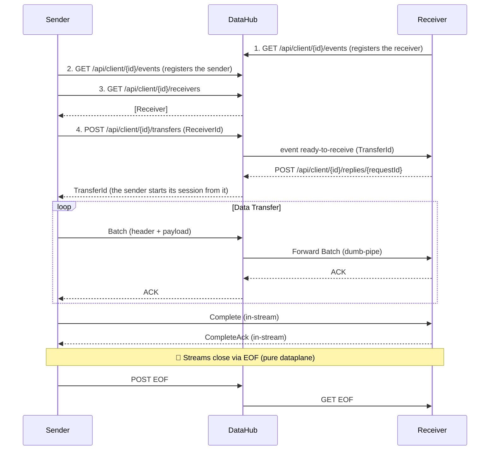

# TransportR - Architecture Overview

> Bulk data transfer through a centralized hub for segmented network environments.

---

## Overview

**TransportR** transfers bulk data between applications through a central hub. Its primary value is simplifying network topology: instead of N×M direct connections, all clients connect only to the hub (N+M connections).

### Core Projects

```
TransportR/                              # Interfaces, protocols, abstractions
TransportR.Client/                       # Control requests, event stream and HTTP streaming client & OAuth2 auth
TransportR.Hub/                          # HTTP API server (control and data planes) & group flow control
TransportR.Serialization.MessagePack/    # MessagePack + Lz4 serializer
TransportR.Serialization.Protobuf/       # Protobuf + Zstd serializer
TransportR.Serialization.Json/           # System.Text.Json + Zstd serializer (uncompressed for debugging)
TransportR.Serialization.Arrow/          # Apache Arrow RecordBatch serializer
TransportR.Auth.SimpleIdp/               # Lightweight Identity Provider (dev/test)
TransportR.Storage.Redis/                # Redis State Store implementation
```

### Key Characteristics

| Aspect | Description |
|--------|-------------|
| **Network Simplification** | Single ingress point for all transfers |
| **Dumb Pipe Architecture** | Hub forwards variable-length opaque bytes without deserialization |
| **Reliable Delivery** | Packet-level ACK with automatic retry |
| **Group-based Access** | Route transfers by logical groups |
| **Observability** | Hub-side byte counting via `IHubProgressMonitor` |

---

## Detailed Architecture

### Data Flow



> **Note**: Transfer completion uses pure dataplane signals (HTTP EOF), not the control plane.
> See [ResilienceArchitecture.md](./ResilienceArchitecture.md#transfer-completion-eof-domino-sequence) for details.

### Control Plane vs Data Plane

TransportR clearly separates responsibilities between coordination and transfer:

1. **Control Plane (HTTP requests and server-sent events)**
    - **Role**: "The Coordinator"
    - **Methods**: a client opens `GET /api/client/{id}/events`, a stream of server-sent events by which the hub reaches it, and asks the hub for the rest with ordinary requests under the same path (see *Communication Channels*)
    - **Responsibility**: Manages presence, lightweight signaling, and state synchronization. It negotiates the transfer parameters but never touches the bulk data.

2. **Data Plane (HTTP Streaming)**
    - **Role**: "The Pipe"
    - **Methods**: `POST /api/stream/{id}/send`, `GET /api/stream/{id}/receive`, and `POST /api/stream/{id}/abort` for the one case a stream cannot carry (see *Abort request* below)
    - **Responsibility**: Moves batches of data. The **Hub** acts as a **Dumb Pipe**, forwarding opaque binary chunks from Sender to Receiver without inspecting or deserializing the payload.

### Communication Channels

| Channel | Transport | Usage |
|---------|-----------|-------|
| **Control plane: events** | HTTP GET, server-sent events (`/api/client/{id}/events`) | Hub → Client. Opening it registers the client and its end marks the client disconnected. Events: `registered` (first, at once), `keepalive`, `ready-to-receive`, `request-send`, `cancel-transfer` |
| **Control plane: requests** | HTTP (`/api/client/{id}/…`) | Client → Hub: `GET receivers` (discovery), `POST transfers` (open a transfer), `POST replies/{requestId}` (answer to an event that asks), `POST presence/{connectionId}`, `POST transfers/{transferId}/heartbeat`, `POST transfers/{transferId}/ping` (the probe before a session reopens its streams) |
| **Data Send** | HTTP POST (`/api/stream/{id}/send`, Header: `X-Connection-Type: Data`) | Sender → Hub |
| **Data Receive** | HTTP GET (`/api/stream/{id}/receive`, Header: `X-Connection-Type: Data`) | Hub → Receiver |
| **Control Send** | HTTP POST (Header: `X-Connection-Type: Control`) | ACKs Receiver → Hub |
| **Control Receive** | HTTP GET (Header: `X-Connection-Type: Control`) | ACKs Hub → Sender |
| **Abort request** | HTTP POST (`/api/stream/{id}/abort`) | Participant → Hub, when its in-stream `Abort` cannot be written because the data in front of it fills the stream; the hub ends the transfer |
| **Token renewal** | HTTP PUT (`/api/client/{id}/token`) | Client → Hub, ahead of the token's expiry |

Every control request names the client in its path and carries the token the client holds at that moment; with
authentication on, it is refused with a 404 unless the path's `clientId` is the identity that token attests.
The events stream is HTTP/1.1 like the data streams (below); a reverse proxy must forward it as it is written
rather than buffer it, and keep its idle timeout above the hub's keepalive interval (*Key Timings* in
`ResilienceArchitecture.md`).

### Data Plane Transport: HTTP/1.1

The data-plane streams are HTTP/1.1, and the client says so on every stream request (`HttpVersion.Version11`,
`RequestVersionExact`, in `HttpStreamManager`). It is a decision, not a default left alone:

- **HTTP/2 has nothing to offer this traffic.** A participant holds two long-lived streams per transfer:
  there is nothing to multiplex and no request header worth compressing.
- **HTTP/2 caps an upload at its flow-control window.** With Kestrel's default windows, one sender-to-hub stream
  reached 16 MB/s at 20 ms round-trip and 4.7 MB/s at 80 ms (h2c, loopback behind a latency-injecting TCP proxy).
  A hub host can raise `Http2.InitialStreamWindowSize`; HTTP/1.1 needs no such tuning.
- **The client's write side relies on HTTP/1.1.** A POST's response is read as the end of its body
  (`HttpStreamManager`). Under HTTP/2 the response is delivered while the body is still being written, so an
  early 2xx would end the stream with a writer still running.

For a deployment:

- Kestrel may offer HTTP/2 to other clients; TransportR clients do not ask for it.
- Write requests carry `Expect: 100-continue`. Over HTTP/1.1 it is what lets the client see a cut on a stream it
  has nothing to write on (see "Disconnection Detection" in `ResilienceArchitecture.md`). A reverse proxy in front
  of the hub must accept it: one that answers `417` fails every write stream.
- A reverse proxy must forward a request body as it arrives, not hold it in a buffer until the buffer fills or the
  body ends. The acknowledgements and the `Complete` chunk that close a transfer are small writes that follow the
  last batch after a pause: held back, they leave the sender to fail after its stall bound although every item was
  delivered. YARP 2.3 with its default HTTP/1.1 upstream does this: 30 bytes written 50 ms after a large write were
  still held 2.5 s later, where straight to the backend they arrive at once. The reference proxy in
  `tests/TransportR.TestProxy` flushes every write through a wrapped outbound handler. The hub asks the same of a
  proxy for the streams it writes to (`X-Accel-Buffering: no`, which nginx honours). No response can ask it for a
  request body. Behind nginx, its documentation calls for `proxy_request_buffering off`,
  `proxy_http_version 1.1` (the default only from nginx 1.29.7; before it, a chunked body is buffered whatever the
  first says) and `client_max_body_size 0` (1 MB by default, then 413). Neither nginx nor any proxy but the reference
  one has been tried.
- A reverse proxy that speaks HTTP/2 to the hub is not covered: that hop has not been validated.

### Resilience & Reliability

TransportR utilizes a **Dataplane First** resilience strategy:

- **Stream Handshake (Ping/Pong)**: After a cut, the client probes the hub with a request, then reopens its streams once it answers; a Ping/Pong on the new data stream tells the sender where the receiver stands.
- **Packet-Level Resumption**: Receiver indicates the exact offset to resume from, eliminating the need for Hub-side state (Checkpoints).
- **Sender-side Buffering**: Payloads are kept until End-to-End ACK is received.
- **Hub Lifecycle Management**: Hub terminates transfers that go silent (timeout), and, if configured, those that stop progressing.

See [ResilienceArchitecture.md](./ResilienceArchitecture.md) for the complete design.

### Security

Authentication and Authorization are handled via OAuth2/JWT with group-based scoping (`transportr:group:*`).
See [SecurityArchitecture.md](./SecurityArchitecture.md) for the security model.

### High Availability (HA)

TransportR supports horizontal scaling (Active/Active) for Hubs:

1. **Shared State**: Client registrations and transfer sessions are stored in Redis
   (`TransportR.Storage.Redis`) -> Used for registration, discovery and routing.
2. **Sticky Sessions**: Required at the Load Balancer level. A client has an affinity of its own, that of the instance holding its events stream, which its registration, discovery, presence and renewal requests carry. A transfer has another, that of the instance holding its bridge, which its handshake, its replies, its heartbeats, its probe and its data streams carry. The client sets the `Cookie` header request by request, and its HTTP handler holds no cookie container, which would override it.
3. **Affinity Handoff**: A sender whose receiver's events stream is held by another instance is answered `421` with the cookie that reaches that instance, and sends that one `InitTransfer` request again with it. Its own events stream does not move, and neither do its other transfers. A stream opened without a cookie whose response sets one is opened once more carrying it, since the registration would otherwise record no instance.
4. **TestProxy**: A YARP-based reference implementation is provided for testing HA locally; `ha-transfer-affinity` is the scenario that exercises the redirection and the affinity of each transfer.

**What is *not* shared, and why sticky sessions are a requirement rather than an optimisation**:
the per-transfer progress counters (`TransferState`: items sent, acks, last activity) live in a
dictionary local to the hub instance that registered the transfer or accepted one of its streams,
never in `IStateStore`. `TransferCleanupService` kills a transfer on those counters, so a deployment
where a transfer's heartbeats and streams reach different instances gives each one a half-silent
transfer and invites both to reap it. Moving the
counters into Redis would buy a case the deployment already excludes, at the price of a write per
heartbeat — so the constraint is written here instead: **HA requires effective affinity, not merely
preferred affinity.**

---

## Core Interfaces

| Interface | Purpose | Location |
|-----------|---------|----------|
| `IDataSender<T>` | Initiate transfers, discover receivers | [ITransportRClient.cs](src/TransportR/Interfaces/ITransportRClient.cs) |
| `IDataReceiver<T>` | Receive transfers via event | [ITransportRClient.cs](src/TransportR/Interfaces/ITransportRClient.cs) |
| `IBatchSerializer<T>` | Pluggable serialization | [IBatchSerializer.cs](src/TransportR/Interfaces/IBatchSerializer.cs) |
| `IHubProgressMonitor` | Hub-side monitoring (bytes only) | [IHubProgressMonitor.cs](src/TransportR/Interfaces/IHubProgressMonitor.cs) |

> The hub operates as a "dumb-pipe" and only tracks bytes.

## Observability

**The packages emit no metrics of their own.** Two hooks are provided and the host decides what to
do with them: `IHubProgressMonitor` on the hub side, and the `TransferInfo` records
`GetTransfers()` returns on the client side. `samples/DataHub` builds its own OpenTelemetry meter
on top of the first — copy it rather than expect one from the package.

---

## Binary Protocol

### Wire Format (v2)

The transport protocol uses a **30-byte fixed header** followed by an **opaque binary payload**. The payload serialization is completely decoupled via `IBatchSerializer<T>`.

```
┌──────────────────────────────────────────────────────────────┐
│ ChunkHeader (30 bytes fixed)                                 │
├──────────────────────────────────────────────────────────────┤
│ Version  │ Type │ PayloadLen │ BatchId │ Count │ TransferId │
│ 1 byte   │ 1 b  │ 4 bytes    │ 4 bytes │ 4 b   │ 16 bytes   │
├──────────────────────────────────────────────────────────────┤
│ Payload (variable length, opaque bytes)                      │
│ ← Serialized by IBatchSerializer<T> implementation           │
└──────────────────────────────────────────────────────────────┘
```

### ChunkType Values

| Type | Value | Description |
|------|-------|-------------|
| Batch | 0x01 | Data payload (serialized items) |
| BatchAck | 0x02 | Batch acknowledgment |
| Complete | 0x03 | Transfer complete signal (requires CompleteAck) |
| CompleteAck | 0x04 | Acknowledgment of Complete (ensures reliable termination) |
| Ping | 0x05 | Connection probe (sender → receiver) |
| Pong | 0x06 | Connection probe response; `BatchId` carries the receiver's next expected batch, the resume point |
| Abort | 0x07 | One end gave up; `BatchId` carries an `AbortReason` |

> **Architectural Note:** The transport layer is **serializer-agnostic**. The `IBatchSerializer<T>` interface allows pluggable implementations (MessagePack, JSON, ProtoBuf, Arrow). It is typed so that a client built on a serializer that cannot carry its item type does not compile. A batch body the receiver cannot decode fails its session instead of being resent: it arrived whole, and a resend would decode no better.

---

## Integration

See [README.md](./README.md) for code examples (Server, Sender, Receiver).

---

## Tests

Unit and integration tests cover the critical components:

- `BatchAccumulator` — Flush strategies, batch IDs
- `ReceiverState` — Ordering, duplicates
- `ChunkIO` — Binary protocol read/write
- `FlowControlService` — Group permissions, wildcards
- `StateStore` — InMemory + Redis (a container, or a local `redis-server`)
- `TransferManager` — Lifecycle (No persistence)

Run: `dotnet test`

---


## Performance

The measured rates, their conditions and what caps one transfer are in the README, under
["Performance, and its conditions"](./README.md#performance-and-its-conditions).

Run benchmarks: `./scripts/run-benchmark.sh`

---
