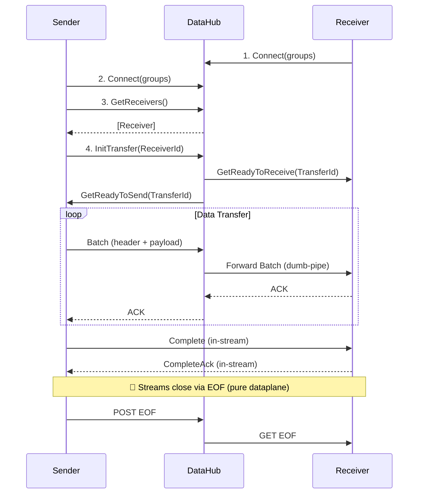

# TransportR - Architecture Overview

> Bulk data transfer through a centralized hub for segmented network environments.

---

## Overview

**TransportR** transfers bulk data between applications through a central hub. Its primary value is simplifying network topology: instead of N×M direct connections, all clients connect only to the hub (N+M connections).

### Core Projects

```
TransportR/                              # Interfaces, protocols, abstractions
TransportR.Client.SignalR/               # SignalR + HTTP streaming client
TransportR.Hub.SignalR/                  # SignalR Hub + HTTP API server
TransportR.Serialization.MessagePack/    # MessagePack + Lz4 serializer
TransportR.Serialization.Protobuf/       # Protobuf + Zstd serializer
TransportR.Serialization.Json/           # System.Text.Json serializer (debug)
TransportR.Serialization.Arrow/          # Apache Arrow RecordBatch serializer
TransportR.FlowControl/                  # Group-based access control
TransportR.Auth.ClientCredentials/       # OAuth2 Client Credentials
TransportR.Auth.SimpleIdp/               # Lightweight Identity Provider
TransportR.Storage.Redis/                # Redis State Store implementation
```

### Key Characteristics

| Aspect | Description |
|--------|-------------|
| **Network Simplification** | Single ingress point for all transfers |
| **Dumb Pipe Architecture** | Hub forwards variable-length opaque bytes without deserialization |
| **Reliable Delivery** | Packet-level ACK with automatic retry |
| **Group-based Access** | Route transfers by logical groups |
| **Observability** | Hub-side byte counting via `IHubProgressMonitor` |

---

## Detailed Architecture

### Data Flow



> **Note**: Transfer completion uses pure dataplane signals (HTTP EOF), not SignalR control plane.
> See [ResilienceArchitecture.md](./ResilienceArchitecture.md#transfer-completion-eof-domino-sequence) for details.

### Control Plane vs Data Plane

TransportR clearly separates responsibilities between coordination and transfer:

1. **Control Plane (SignalR)**
    - **Role**: "The Coordinator"
    - **Methods**: `Connect`, `GetReceivers`, `InitTransfer`
    - **Responsibility**: Manages presence, lightweight signaling, and state synchronization. It negotiates the transfer parameters but never touches the bulk data.

2. **Data Plane (HTTP Streaming)**
    - **Role**: "The Pipe"
    - **Methods**: `POST /api/stream/{id}/send`, `GET /api/stream/{id}/receive`
    - **Responsibility**: Moves batches of data. The **Hub** acts as a **Dumb Pipe**, forwarding opaque binary chunks from Sender to Receiver without inspecting or deserializing the payload.

### Communication Channels

| Channel | Transport | Usage |
|---------|-----------|-------|
| **Control** | SignalR (`/hub/command`) | Handshake, discovery, heartbeat |
| **Data Send** | HTTP POST (`/api/stream/{id}/send`) | Sender → Hub |
| **Data Receive** | HTTP GET (`/api/stream/{id}/receive`) | Hub → Receiver |
| **Control Send** | HTTP POST (Header: `X-Connection-Type: Control`) | ACKs Receiver → Hub |
| **Control Receive** | HTTP GET (Header: `X-Connection-Type: Control`) | ACKs Hub → Sender |

### Resilience & Reliability

TransportR utilizes a **Dataplane First** resilience strategy:

- **Stream Handshake (Ping/Pong)**: Verifies end-to-end reachability via the data stream itself (not SignalR).
- **Packet-Level Resumption**: Receiver indicates the exact offset to resume from, eliminating the need for Hub-side state (Checkpoints).
- **Sender-side Buffering**: Payloads are kept until End-to-End ACK is received.
- **Hub Lifecycle Management**: Hub actively terminates transfers that show no progress (timeout).

See [ResilienceArchitecture.md](./ResilienceArchitecture.md) for the complete design.

### Security

Authentication and Authorization are handled via OAuth2/JWT with group-based scoping (`transportr:group:*`).
See [SecurityArchitecture.md](./SecurityArchitecture.md) for the security model.

### High Availability (HA)

TransportR supports horizontal scaling (Active/Active) for Hubs:

1. **Shared State**: Client registrations are stored in Redis (`TransportR.Storage.Redis`) -> Used for initial Connection/Discovery.
2. **Sticky Sessions**: Required at the Load Balancer level for SignalR connections.
3. **Affinity Handoff**: Hubs can redirect clients to the correct instance if they land on the wrong node.
4. **TestProxy**: A YARP-based reference implementation is provided for testing HA locally.

---

## Core Interfaces

| Interface | Purpose | Location |
|-----------|---------|----------|
| `IDataSender<T>` | Initiate transfers, discover receivers | [ITransportRClient.cs](src/TransportR/Interfaces/ITransportRClient.cs) |
| `IDataReceiver<T>` | Receive transfers via event | [ITransportRClient.cs](src/TransportR/Interfaces/ITransportRClient.cs) |
| `IBatchSerializer<T>` | Pluggable serialization | [IBatchSerializer.cs](src/TransportR/Interfaces/IBatchSerializer.cs) |
| `IHubProgressMonitor` | Hub-side monitoring (bytes only) | [IHubProgressMonitor.cs](src/TransportR/Interfaces/IHubProgressMonitor.cs) |

> The hub operates as a "dumb-pipe" and only tracks bytes.

## Observability

**The packages emit no metrics of their own.** Two hooks are provided and the host decides what to
do with them: `IHubProgressMonitor` on the hub side, and the `TransferInfo` records
`GetTransfers()` returns on the client side. `samples/DataHub` builds its own OpenTelemetry meter
on top of the first — copy it rather than expect one from the package.

---

## Binary Protocol

### Wire Format (v1)

The transport protocol uses a **30-byte fixed header** followed by an **opaque binary payload**. The payload serialization is completely decoupled via `IBatchSerializer<T>`.

```
┌──────────────────────────────────────────────────────────────┐
│ ChunkHeader (30 bytes fixed)                                 │
├──────────────────────────────────────────────────────────────┤
│ Version  │ Type │ PayloadLen │ BatchId │ Count │ TransferId │
│ 1 byte   │ 1 b  │ 4 bytes    │ 4 bytes │ 4 b   │ 16 bytes   │
├──────────────────────────────────────────────────────────────┤
│ Payload (variable length, opaque bytes)                      │
│ ← Serialized by IBatchSerializer<T> implementation           │
└──────────────────────────────────────────────────────────────┘
```

### ChunkType Values

| Type | Value | Description |
|------|-------|-------------|
| Batch | 0x01 | Data payload (serialized items) |
| BatchAck | 0x02 | Batch acknowledgment |
| Complete | 0x03 | Transfer complete signal (requires CompleteAck) |
| CompleteAck | 0x04 | Acknowledgment of Complete (ensures reliable termination) |
| Ping | 0x05 | Connection probe (sender → receiver) |
| Pong | 0x06 | Connection probe response |

> **Architectural Note:** The transport layer is **serializer-agnostic**. The `IBatchSerializer<T>` interface allows pluggable implementations (MessagePack, JSON, ProtoBuf, Arrow). It is typed so that a client built on a serializer that cannot carry its item type does not compile. The included `TransportR.Serialization.MessagePack` uses MessagePack with Lz4 compression for high performance.

---

## Integration

See [README.md](./README.md#quick-start) for code examples (Server, Sender, Receiver).

---

## Tests

Unit and integration tests cover the critical components:

- `BatchAccumulator` — Flush strategies, batch IDs
- `ReceiverState` — Ordering, duplicates
- `ChunkIO` — Binary protocol read/write
- `FlowControlService` — Group permissions, wildcards
- `StateStore` — InMemory + Redis (Docker)
- `TransferManager` — Lifecycle (No persistence)

Run: `dotnet test`

---


## Performance

TransportR can achieve **hundreds of thousands of items per second** with favorable network conditions and appropriate batch sizes.

Run benchmarks: `./scripts/run-benchmark.sh`

---
